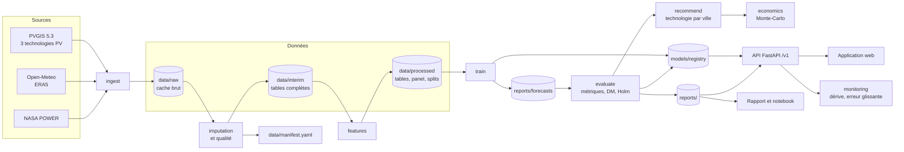

# Architecture de SolarVision v2

Ce document dit où se trouve chaque chose et comment les étapes s'enchaînent. Il décrit ce qui tourne
réellement sur une machine locale ; les limites sont listées à la fin.

## Vue d'ensemble

## Les étapes

Chaque étape est une commande de `python -m solarvision.cli`. L'option `--fast` la limite à trois villes
(Paris, Tunis, Madrid) et écrit dans `data/fast/`.

| Étape | Commande | Entrées | Sorties |
|---|---|---|---|
| Ingestion | `ingest` | API PVGIS, Open-Meteo, NASA POWER | `data/raw/`, `data/failures.json` |
| Imputation et qualité | `ingest --reprocess` | `data/raw/` | `data/interim/`, `data/processed/<ville>.csv`, `data/quality/`, `data/manifest.yaml` |
| Variables | `features` | `data/interim/` | `data/processed/panel_*.parquet`, `splits_90_10.yaml` |
| Entraînement | `train` | panel, splits | `reports/forecasts/<ville>.parquet` |
| Évaluation | `evaluate` | prévisions | `reports/metrics_tidy.csv`, `dm_tests.csv`, `synthese_ville.csv` |
| Recommandation | `recommend` | panel, métriques | `reports/tech_recommendation.csv` |
| Économie | `economics` | productibles, hypothèses | `reports/economics_by_city.csv` |
| Enregistrement | `register` | modèle, métriques | `models/registry/` |
| Service | `serve` | registre, rapports | API sur le port 8000 |
| Rapport | `report` | `reports/` | rapport Word et PDF |

## Où trouver quoi

| Je cherche | Emplacement |
|---|---|
| La liste des villes et leurs coordonnées | `configs/cities.yaml` |
| La graine, le découpage, les seuils | `configs/params.yaml` |
| Les hypothèses économiques | `configs/economics.yaml` |
| Les poids du score de fiabilité | `configs/reliability.yaml` |
| Les réponses brutes des API | `data/raw/<source>/<ville>/` |
| La table journalière d'une ville | `data/processed/<ville>.csv` (3 séries PV), `data/interim/<ville>.parquet` (toutes les variables) |
| Le panel de modélisation et les découpages | `data/processed/` |
| L'origine, la licence et l'empreinte de chaque fichier | `data/manifest.yaml` |
| Les contrôles de qualité par ville | `data/quality/` |
| Les villes en échec et l'heure de reprise | `data/failures.json` |
| Les prévisions date par date | `reports/forecasts/` |
| Les métriques et les tests statistiques | `reports/` |
| Les modèles et la version en production | `models/registry/`, `models/registry/current.json` |
| Le code | `src/solarvision/` |
| Les tests | `tests/` |
| L'avancement et les décisions | `docs/PROGRESS.md`, `docs/adr/` |
| L'étude historique sur 9 villes | `python/`, `mini_projet_python.ipynb`, `resultats/`, `rapport/` |
| Le code R | dossier R autonome, à la racine |

## Le code

| Paquet | Rôle |
|---|---|
| `solarvision.config` | Lecture et validation de `configs/` |
| `solarvision.cli` | Point d'entrée unique |
| `solarvision.data` | Ingestion, imputation, qualité, manifeste |
| `solarvision.features` | Panel, variables ex ante et ex post, découpages |
| `solarvision.models` | Références, modèles statistiques, apprentissage automatique, réseaux récurrents |
| `solarvision.evaluation` | Métriques, Diebold-Mariano, Holm, bootstrap |
| `solarvision.recommender` | Fiabilité par technologie, recommandation |
| `solarvision.economics` | VAN, temps de retour, LCOE, CO2, Monte-Carlo |
| `solarvision.mlops` | Registre, promotion, retour arrière |
| `solarvision.serving` | API |
| `solarvision.monitoring` | Dérive et suivi des erreurs |

## Règles qui structurent le code

- **Configuration hors du code.** Aucun seuil, aucune ville, aucun tarif n'est écrit dans un module.
- **Cache brut immuable.** Un fichier de `data/raw/` n'est jamais réécrit ; tout le reste se reconstruit.
- **Ex ante et ex post séparés.** Une variable connue seulement après coup n'entre jamais dans un modèle présenté comme opérationnel.
- **Découpage chronologique.** Les 90 % de jours les plus anciens servent à l'apprentissage, sans tirage aléatoire.
- **Jamais de donnée simulée.** Une ville incomplète est listée comme manquante.

## Limites

- **Tout est local.** Pas de stockage distant, pas d'orchestrateur, pas de déploiement dans le nuage.
- **Pas de réentraînement automatique.** Le suivi signale une dérive ; la décision de réentraîner reste humaine.
- **Python 3.14 à l'exécution.** Le projet déclare Python 3.12 ou plus ; les calculs ont été faits avec la version 3.14 installée sur la machine (voir `docs/adr/0001-environnement-et-configuration.md`).
- **Deux générations de code cohabitent.** L'étude historique (9 villes) reste dans ses dossiers d'origine ; la correspondance est dans `docs/MIGRATION.md`.
- **Données simulées.** PVGIS simule la production à partir d'images satellitaires : ce ne sont pas des mesures d'installations réelles.
