# Résumé

Ce projet part du rapport SolarVision, qui estimait la production solaire d'une toiture à Tunis avec une irradiation supposée de 1 800 kWh/m²/an « à remplacer par la valeur PVGIS ». Le lien PVGIS de ce rapport a été interrogé pour 9 villes (Paris, Lyon, Marseille, Tunis, Sfax, Tozeur, Madrid, Séville, Barcelone) sur 2005-2023, puis complété par trois sources de variables exogènes (Open-Meteo/ERA5, NASA POWER) et par les productions nationales mesurées en France et en Espagne. On obtient 14 jeux de données, dont 6 par pays et par thème (photovoltaïque, éclairement), et 58 variables par jour et par ville. La série étudiée est la production journalière d'une installation de 1 kWc à Tunis (6 939 jours). Quatorze modèles sont comparés sur 688 prévisions glissantes à 7 jours.

Quatre résultats ressortent.

- **Le chiffre du rapport SolarVision était juste pour le plan horizontal, pas pour des modules inclinés** : PVGIS donne 1 815 kWh/m²/an à l'horizontale, mais 2 045 sur le plan optimal à 33°, soit 31 700 kWh/an pour 100 m² au lieu de 28 800.
- **Sans prévision météo, rien ne bat durablement la normale saisonnière.** Une fois le cycle annuel retiré, la série se comporte comme un AR(1) de coefficient 0,26. Le meilleur modèle (un LSTM entraîné sur les 9 villes) a un RMSE de 1,078 kWh/kWc contre 1,100 pour la climatologie ; l'écart est significatif à un jour, pas à sept jours.
- **Connaître la météo à venir réduit l'erreur d'un tiers** (SARIMAX météo : 0,725 ; LSTM ex post : 0,699), une borne optimiste puisque la météo observée remplace une prévision.
- **La variance des erreurs suit les saisons.** Un GARCH(1,1) l'interprète à tort comme une volatilité de persistance infinie (alpha + beta = 1,000) ; une variance saisonnière suivie d'un GARCH(1,1) passe tous les diagnostics et rend les intervalles fiables en hiver comme en été.

La cointégration ne s'applique pas aux séries de Tunis, stationnaires ; testée sur un cas réellement non stationnaire (production nationale française et espagnole), elle est rejetée. Le socle classique est codé en R et en Python, avec des RMSE identiques à 0,15 % près. Une application web (prévision avec saisie des derniers relevés, LSTM et ARIMA) et un assistant RAG complètent l'étude.

# 1. Introduction

**Thématique et série retenues.** Nous avons choisi l'option B et la production photovoltaïque journalière de Tunis, parce que le rapport SolarVision que nous avions rédigé en vision par ordinateur s'arrêtait à un ordre de grandeur annuel, et que le lien PVGIS qu'il citait donnait accès à 19 ans de séries horaires : passer de cet ordre de grandeur à une prévision est un vrai problème de séries temporelles.

**Enjeu.** Un exploitant de toitures solaires a besoin de prévoir la production des jours suivants pour planifier le nettoyage et la maintenance, piloter une batterie ou s'engager auprès du réseau. Un architecte (l'utilisateur visé par SolarVision) a besoin d'un productible fiable pour dimensionner l'installation.

**Question de modélisation.** Peut-on prévoir à 7 jours la production journalière d'une installation photovoltaïque à Tunis, et que gagne-t-on à connaître la météo à venir ? Les huit autres villes servent de comparaison et d'apprentissage supplémentaire.

**Démarche.** Chaque choix (transformation, différenciation, ordres, variables, architecture) est justifié par un diagnostic. Les modèles sont comparés sur le même échantillon de test, avec les mêmes métriques et deux références naïves, et les écarts sont testés. Les résultats négatifs sont rapportés au même titre que les autres.

# 2. Données et préparation

## 2.1 Des liens du rapport SolarVision aux données

Le script `python/collecte_donnees.py` lit les 21 hyperliens distincts du PDF du rapport, les classe et visite chacun d'eux (résultat archivé dans `sources/liens_rapport_solarvision.json`). Un seul donne accès à des séries temporelles : **PVGIS** (Commission européenne, JRC). Les 14 articles (arXiv, Nature, NeurIPS, PMC) ont fourni leur résumé au corpus de l'assistant ; les 5 jeux d'images aériennes (Inria, figshare, WHU, SpaceNet) ont seulement été décrits.

| Source | Contenu utilisé | Fréquence |
|---|---|---|
| PVGIS 5.3 (lien du rapport) | puissance d'1 kWc, éclairement incliné et horizontal, hauteur du soleil, température, vent | horaire |
| Open-Meteo (réanalyse ERA5) | nébulosité, ensoleillement, pluie, humidité, point de rosée, pression, rafales, ET0, rayonnement ERA5 | journalière |
| NASA POWER (MERRA-2, CERES) | rayonnement par ciel clair, indice de clarté, aérosols, UV, albédo, rayonnement photosynthétique | journalière |
| RTE éCO2mix, REE | production solaire nationale mesurée en France et en Espagne | 30 min et journalière |

Table: Sources de données.

**Période :** 2005-2023 (couverture de la base satellitaire PVGIS-SARAH3), soit 6 939 jours par ville ; 2012-2026 pour RTE, 2014-2026 pour REE. **Installation simulée :** 1 kWc de modules au silicium cristallin, plein sud, à la pente optimale de chaque site (33° pour les trois villes tunisiennes, 35 à 39° ailleurs), avec 14 % de pertes système.

## 2.2 Jeux de données et variables

{{TABLEAU_JEUX}}

Les variables journalières (58 par ville, 64 colonnes dans le panel) se regroupent en sept familles : production (énergie, pic, heures de production, ratio de performance) ; éclairement énergétique (global, direct, diffus, sur le plan des modules et à l'horizontale) ; **éclairage naturel**, calculé à partir des composantes horizontales (éclairement lumineux maximal en klux, heures au-dessus de 10 000 lux, dose lumineuse, heures où un éclairage artificiel est nécessaire) ; météo ERA5 ; aérosols, clarté et UV de NASA POWER ; grandeurs astronomiques connues à l'avance (rayonnement extraterrestre, durée du jour, hauteur du soleil à midi) ; retards (veille, moyenne et écart-type des 7 derniers jours). Le dictionnaire complet est dans `data/LISEZMOI_donnees.md`.

**Transformations du fournisseur.** Le rayonnement PVGIS est estimé par satellite (SARAH3, EUMETSAT) et non mesuré au sol ; la température et le vent viennent de la réanalyse ERA5 ; la puissance est simulée par le modèle de Huld et al. (2011), qui tient compte de la température des modules et des effets spectraux. L'horodatage est en temps universel : à ces longitudes, aucune heure de soleil n'est coupée par minuit UTC, les sommes journalières sont donc exactes.

**Contrôle qualité.** Deux contrôles de cohérence ont révélé 11 à 13 jours par ville où PVGIS renvoie un rayonnement nul alors que le soleil est levé : la hauteur du soleil fournie par PVGIS y est inférieure de plus de 5° à la hauteur astronomique (contre moins de 3° les jours normaux), ou l'irradiation PVGIS vaut moins du quart de celles de NASA POWER et d'ERA5. Ce sont des trous de la base satellitaire, traités en section 3.5.

**Objet série temporelle et découpage.** `DatetimeIndex` de fréquence journalière en Python, objet `ts` de fréquence 365,25 en R. Découpage chronologique : 6 245 jours d'apprentissage (1er janvier 2005 au 5 février 2022) et 694 jours de test (6 février 2022 au 31 décembre 2023), soit près de deux années complètes.

## 2.3 Ce que PVGIS change au rapport SolarVision

| Ville | Pente optimale | Irradiation horizontale (kWh/m²/an) | Irradiation sur le plan (kWh/m²/an) | Productible (kWh/kWc/an) | 100 m² (kWh/an) |
|---|---|---|---|---|---|
| Paris | 38° | 1 211 | 1 415 | 1 131 | 22 619 |
| Lyon | 37° | 1 392 | 1 632 | 1 289 | 25 787 |
| Marseille | 39° | 1 692 | 2 033 | 1 627 | 32 547 |
| **Tunis** | 33° | **1 815** | **2 045** | **1 585** | **31 694** |
| Sfax | 33° | 1 925 | 2 177 | 1 700 | 34 000 |
| Tozeur | 33° | 2 063 | 2 342 | 1 785 | 35 708 |
| Madrid | 37° | 1 783 | 2 094 | 1 620 | 32 406 |
| Séville | 35° | 1 907 | 2 201 | 1 672 | 33 435 |
| Barcelone | 38° | 1 665 | 1 976 | 1 571 | 31 423 |

Table: Synthèse PVGIS (outil PVcalc et moyennes 2005-2023 ; 100 m² = 20 kWc pour des modules de rendement 20 %).

Le rapport SolarVision supposait G = 1 800 kWh/m²/an, un rendement de 20 % et un ratio de performance de 0,8, soit 28 800 kWh/an pour 100 m² et 156 m² pour couvrir 45 000 kWh/an. PVGIS confirme l'irradiation horizontale (1 815), mais des modules inclinés à 33° reçoivent 13 % de plus ; avec les pertes calculées par PVGIS (22,5 %, soit un ratio de performance de 0,78), on obtient 31 694 kWh/an et **142 m²** au lieu de 156. L'erreur du rapport ne venait pas du chiffre, mais du plan auquel il s'appliquait.

# 3. Analyse exploratoire

## 3.1 Visualisation

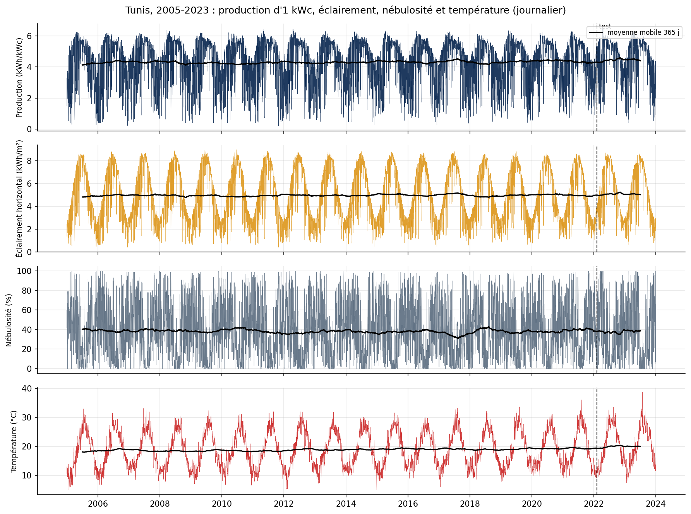{width=14cm}

- **Saisonnalité annuelle marquée mais modérée :** de 3,06 kWh/kWc par jour en décembre à 5,43 en juillet (rapport 1,8, contre environ 3 à Paris).
- **Variance inverse du niveau :** écart-type journalier de 1,25 à 1,53 de décembre à avril, de 0,41 en juillet. L'été tunisien est presque toujours clair ; l'hiver et le printemps alternent ciel clair et perturbations.
- **Pas de tendance :** production annuelle de 1 508 à 1 635 kWh/kWc, écart-type d'une année à l'autre de 37 kWh/kWc (2,3 %). La température, elle, monte (section 3.6).
- **Asymétrie à gauche (skewness -0,82) :** la production est bornée par le ciel clair ; 2,1 % des jours sont sous 1 kWh/kWc.

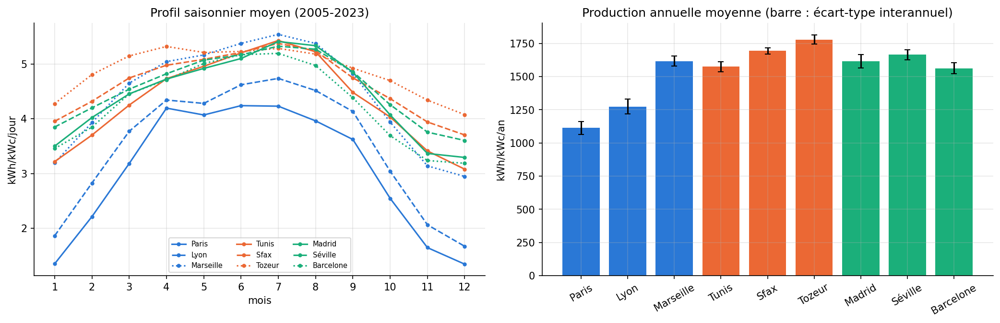{width=15cm}

Le gradient nord-sud est surtout hivernal : en décembre, Paris produit 1,35 kWh/kWc par jour contre environ 4,1 à Tozeur, alors qu'en juillet les neuf villes sont entre 4,2 et 5,5. Tunis, côtière, est plus nuageuse en hiver que le sud tunisien et se place au niveau de Madrid et de Marseille.

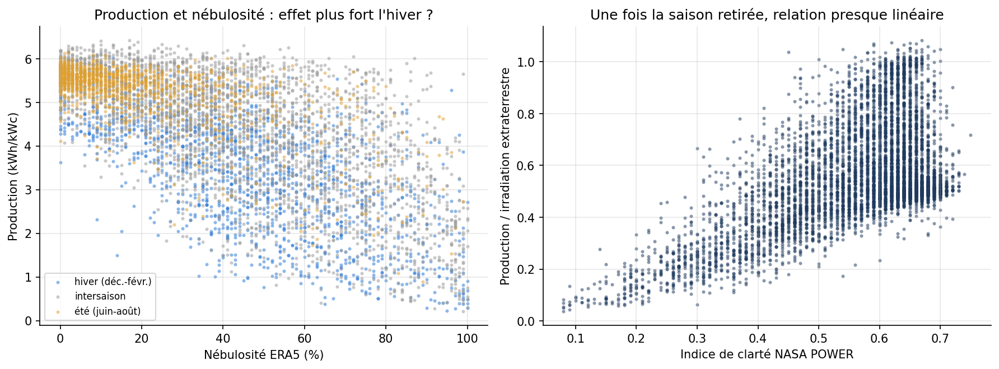{width=13cm}

La corrélation avec la nébulosité vaut -0,69 (de -0,61 en hiver à -0,67 en été), avec une forte dispersion à nébulosité égale. Divisée par le rayonnement extraterrestre, la production suit presque linéairement l'indice de clarté (r = 0,57).

## 3.2 Transformation

L'écart-type mensuel diminue quand le niveau augmente (pente -0,24 ; r = -0,57 ; p = 4e-19), à l'inverse de la situation qui justifie un logarithme ; le logarithme aggraverait l'asymétrie (de -0,82 à -1,99). **La série est modélisée en niveau**, et l'hétéroscédasticité saisonnière est traitée par un modèle de variance (section 4.3).

## 3.3 ACF et PACF

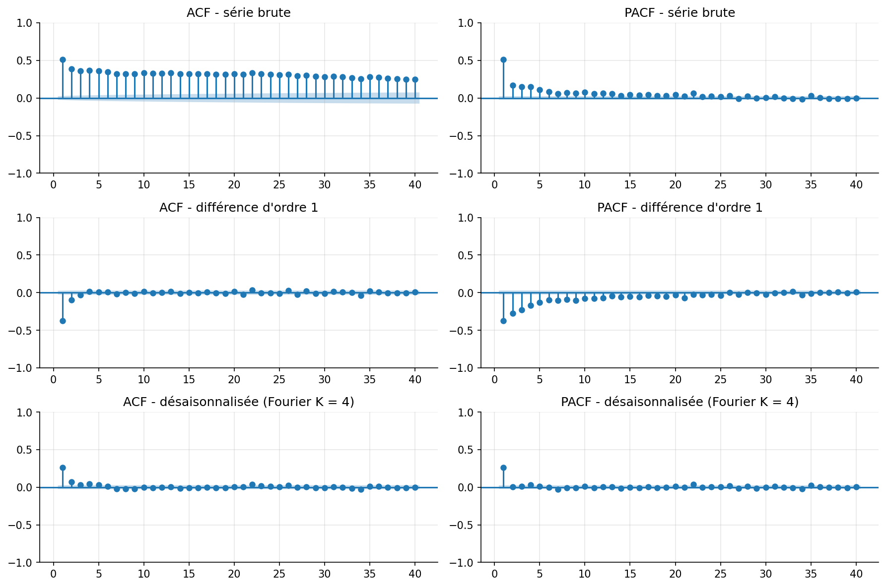{width=13cm}

- **Série brute :** ACF de 0,51 au retard 1, encore 0,28 au retard 30, -0,31 à 182 jours et +0,33 à 365 jours : cette persistance apparente est celle du cycle annuel.
- **Différence d'ordre 1 :** ACF de -0,37 au retard 1, signature d'une sur-différenciation.
- **Série désaisonnalisée** (Fourier, 34 % de la variance) : ACF de 0,26 au retard 1 puis négligeable, PACF coupée après le retard 1 : un **AR(1)**. La météo d'un jour renseigne peu sur celle du lendemain, presque plus sur celle du surlendemain.
- **Ordres candidats :** d = 0, p de 1 à 3, q de 0 à 2, K = 2 à 4 harmoniques. Pas de saisonnalité hebdomadaire.

## 3.4 Décomposition

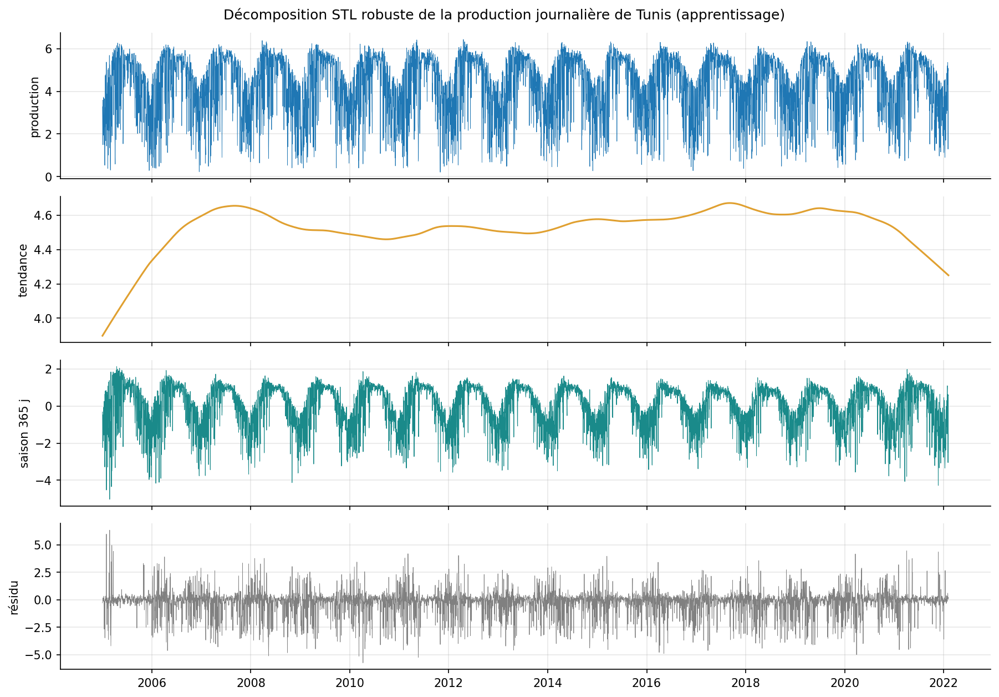{width=13cm}

- **Saison :** 65 % de la variance, très régulière.
- **Tendance :** moins de 1 % de la variance ; +9,5 Wh/kWc par jour et par an (+0,2 % par an), trop faible pour être distinguée d'une dérive de la série satellitaire.
- **Résidu :** 60 % de la variance (parts non additives, composantes corrélées) ; écart-type de 1,40 kWh/kWc en mars contre 0,37 en juillet ; asymétrique (-0,90).

## 3.5 Valeurs aberrantes

Deux familles sont distinguées.

- **Erreurs de données, corrigées.** 13 jours à Tunis où PVGIS donnait 0 à 1,5 kWh/kWc alors que NASA POWER et ERA5 voyaient une journée ordinaire (2,2 à 7,2 kWh/m²) : trous de la base SARAH3 (dix journées entièrement nulles, trois en partie). Ils sont imputés (énergie NASA du jour multipliée par le rapport PVGIS/NASA des 31 jours voisins) et signalés (`jour_impute_pvgis`). Les garder aurait créé de faux records de volatilité.
- **Valeurs extrêmes vraies, conservées.** La règle de l'IQR globale signale 17,5 % des jours, surtout l'hiver, parce que la dispersion y est plus forte : elle est inadaptée. Un **boxplot glissant** (quartiles sur 61 jours) signale 803 jours (12,9 %), dont 595 bas. La moitié des jours bas s'expliquent par une pluie d'au moins 5 mm, un ciel couvert à plus de 80 % ou un épisode de poussières (épaisseur optique d'au moins 0,8) ; les 8 plus bas cumulent ciel couvert et pluie ou poussières.

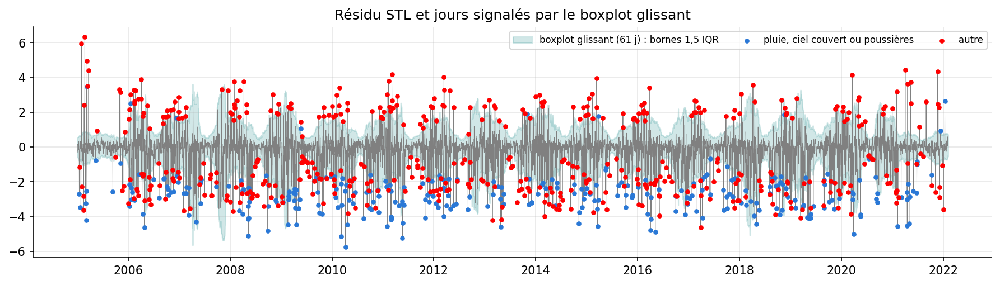{width=13cm}

**Traitement :** aucune suppression ni indicatrice pour les valeurs vraies, imprévisibles ex ante ; elles sont expliquées par la météo dans les modèles ex post, et leur concentration en saison humide est modélisée par la variance conditionnelle.

## 3.6 Stationnarité

{{TABLEAU_STATIONNARITE}}

- **En niveau, les deux tests s'accordent :** l'ADF rejette la racine unitaire et le KPSS ne rejette pas la stationnarité pour la production, la nébulosité et la température.
- **Température désaisonnalisée :** stationnaire autour d'une tendance de **+0,59 °C par décennie** (le KPSS rejette autour d'une constante, pas autour d'une tendance), un réchauffement compatible avec celui observé en Méditerranée.
- **Ordre de différenciation retenu : d = 0 et D = 0**, le cycle annuel étant déterministe et représenté par des termes de Fourier.

## 3.7 Choix des variables

Plus de 50 variables candidates ont été classées par trois critères calculés sur l'apprentissage : corrélation de Spearman, information mutuelle et importance par permutation d'un gradient boosting.

{{TABLEAU_IMPORTANCE}}

- **Ex ante**, la production du lendemain est peu prévisible : 33 variables n'expliquent que 40 % de la variance. Les plus utiles sont la nébulosité satellite de la veille, le rayonnement extraterrestre et l'ensoleillement de la veille ; les trois sources d'irradiation sont redondantes.
- **Ex post**, la météo du jour explique 79 % de la variance, la nébulosité satellite NASA dominant de loin.
- **Choix.** Les modèles ex post ne reçoivent que ce qu'**une prévision météo fournit** : nébulosité ERA5, pluie, humidité, amplitude thermique, aérosols, et l'interaction nébulosité x potentiel solaire. La nébulosité NASA, observation satellite non disponible en prévision, et l'irradiation PVGIS, dont la production est calculée, sont exclues. VIF des variables retenues : au plus 6.

# 4. Modélisation classique

## 4.1 ARIMA à termes de Fourier et SARIMA mensuel

**Pourquoi pas un SARIMA journalier de période 365 ?** Il demanderait un état de plus de 365 dimensions estimé sur 17 cycles. On suit la recommandation de Hyndman et Athanasopoulos (régression harmonique dynamique) : un ARIMA dont le cycle annuel est porté par des termes de Fourier. Le SARIMA au sens strict est estimé sur la série mensuelle.

**Identification.** La grille (p de 1 à 3, q de 0 à 2, K de 2 à 4) retient **ARIMA(1,0,0) + Fourier K = 2** au BIC (18 977,6). `pmdarima.auto_arima` et `auto.arima` en R, avec les mêmes termes de Fourier, retiennent exactement le même modèle, et les tests de différenciation donnent tous d = 0 : identification manuelle et automatique convergent. AR(1) = 0,263 ; écart-type de l'erreur à un jour : 1,10 kWh/kWc.

**SARIMAX météo (ex post).** L'écart-type de l'erreur tombe à 0,767 kWh/kWc (-30 %). Les coefficients ont un sens physique : -0,26 kWh/kWc pour 10 points de nébulosité, un peu moins en été ; -0,063 par mm de pluie ; **-0,96 par unité d'épaisseur optique des aérosols** (un épisode de poussières sahariennes à 1,0 coûte environ 20 % d'une journée moyenne) ; +0,093 par degré d'amplitude thermique. L'AR(1) tombe à 0,11 : la persistance de la production venait de celle de la météo.

{{TABLEAU_DIAGNOSTICS}}

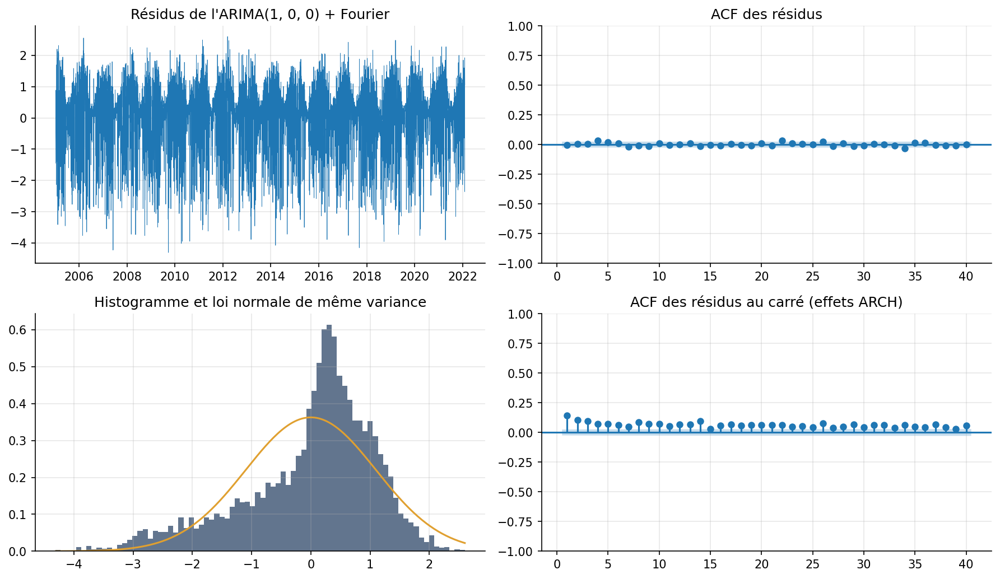{width=12cm}

- **Indépendance :** Ljung-Box non rejeté pour l'ARIMA-Fourier (p = 0,09 et 0,25) ; autocorrélation résiduelle maximale de 0,035, négligeable.
- **Normalité (test de Jarque-Bera) :** rejetée (p < 0,001) ; asymétrie -0,94, kurtosis 3,71. Les mauvaises surprises sont plus fortes que les bonnes, la production étant bornée par le ciel clair.
- **Homoscédasticité :** massivement rejetée (ARCH-LM = 235) ; écart-type des résidus de 1,21 en hiver contre 0,64 en été. La moyenne est bien spécifiée, pas la variance.

**SARIMA mensuel (s = 12).** OCSB et Canova-Hansen ne demandent pas de différence saisonnière, mais l'ACF de la différence saisonnière présente un pic négatif au retard 12 (-0,51) ; le BIC retient SARIMA(0,0,0)(0,1,1)[12] avec un coefficient saisonnier de -0,889, proche de -1 : la différence est presque annulée, ce qui rejoint les tests (saisonnalité déterministe). Les résidus sont blancs, gaussiens et homoscédastiques : à la maille mensuelle, les aléas journaliers se compensent. À 6 mois (18 origines), le SARIMA (RMSE de 12,4 kWh/kWc par mois) fait jeu égal avec la moyenne mensuelle (12,3) et bat le naïf saisonnier (17,7).

## 4.2 VAR, causalité de Granger et cointégration

**VAR(3)** sur (production, nébulosité, température), termes de Fourier en exogènes ; AIC et BIC choisissent 3 retards. Le Portmanteau multivarié rejette de peu (p = 0,018) mais chaque équation passe le test de Ljung-Box ; le VAR est stable.

{{TABLEAU_GRANGER}}

- **Nébulosité et production se prévoient mutuellement** : elles mesurent le même état du ciel. La production de la veille prévoit la température (une journée claire réchauffe le sol et l'air). La causalité de Granger mesure la prévisibilité, pas la causalité physique.
- **Réponse impulsionnelle** (nébulosité placée en premier) : un choc d'un écart-type de nébulosité réduit la production de 0,66 kWh/kWc le jour même, de 0,35 le lendemain, et l'effet disparaît en 4 jours ; il explique 44,5 % de la variance d'erreur à 7 jours.
- **Autres pays :** le même jour, aucune corrélation avec Séville, Madrid, Barcelone ou Marseille ; mais l'anomalie de la veille à Barcelone (r = 0,12) ou à Marseille aide à prévoir Tunis (F = 108,5 et 37,0), sans réciproque comparable, ce qui est cohérent avec des perturbations qui traversent la Méditerranée occidentale avant la Tunisie (hypothèse que le test ne prouve pas).

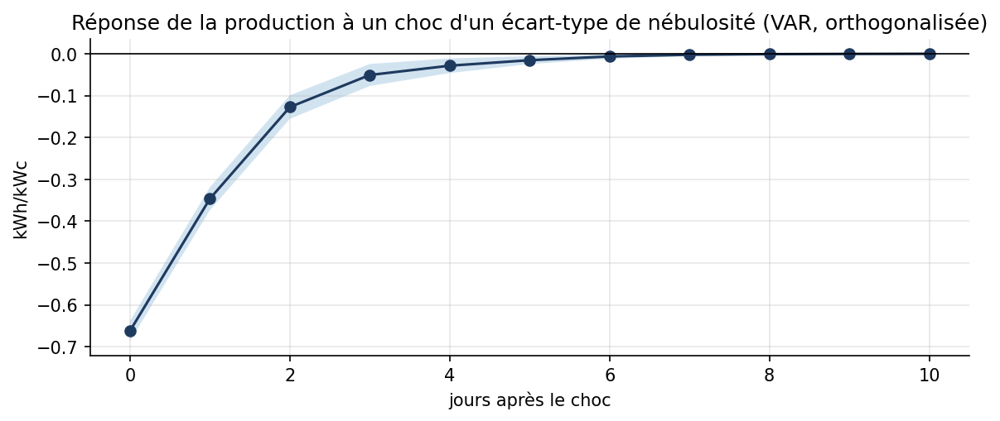{width=10cm}

**Cointégration.** Pour Tunis, le test de Johansen trouve un **rang plein** (trace de 2 129, 993 et 62 pour des seuils de 29,8 ; 15,5 et 3,8) : le système est stationnaire en niveaux, la cointégration ne s'applique pas (l'Engle-Granger « significatif » est trompeur). Le cas a donc été posé là où il a un sens : les productions solaires nationales mesurées, qui croissent avec le parc. Sur 2014-2026, le log de chacune est I(1) ; Engle-Granger (p = 0,38) et la trace de Johansen (15,1 contre 18,4 pour « rang = 0 ») concluent à **l'absence de cointégration**, en Python comme en R. Le VECM de vérification (rang imposé à 1) donne des coefficients d'ajustement de -0,0007 et -0,0008, sans force de rappel : la production espagnole a été multipliée par 6,7 entre 2018 et 2025, la française par 3,1. Aucun VECM n'est retenu.

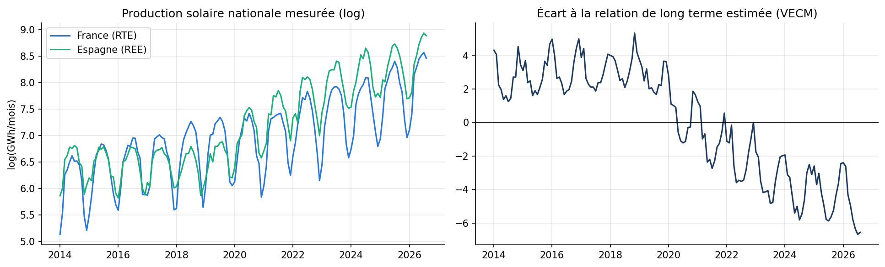{width=14cm}

## 4.3 Volatilité conditionnelle : ARCH et GARCH

{{TABLEAU_GARCH}}

- **Le GARCH(1,1) estime alpha + beta = 1,000** : un GARCH intégré, comme si chaque choc de volatilité durait indéfiniment. C'est un artefact : la variance suit les saisons, et le GARCH prend un changement déterministe pour des chocs persistants. Ses résidus standardisés échouent encore à l'ARCH-LM (p = 0,007), comme ceux des ordres voisins, du GJR et de l'EGARCH.
- **Modèle retenu : variance saisonnière + GARCH(1,1) Student asymétrique.** La composante saisonnière de la variance est retirée (régression de log e² sur deux harmoniques), puis le reste suit un GARCH(1,1). Seul à passer le diagnostic (ARCH-LM p = 0,39), il a aussi le meilleur AIC et le meilleur BIC. Sa persistance tombe à 0,53 : hors saison, un choc de volatilité s'éteint en un à deux jours.
- **Événements :** volatilité quatre fois plus forte en mars qu'en juillet ; les dix jours les plus volatils tombent en mars-avril, au lendemain d'une grosse erreur négative sous un ciel couvert ; 1,49 au lendemain d'une pluie d'au moins 5 mm contre 1,09 sinon.
- **Utilité :** à variance constante, l'intervalle à 95 % à un jour couvre 92,9 % des jours de novembre à mars et 96,5 % d'avril à octobre. Le modèle retenu couvre 97,4 % et 96,7 %, avec un intervalle en moyenne plus étroit.

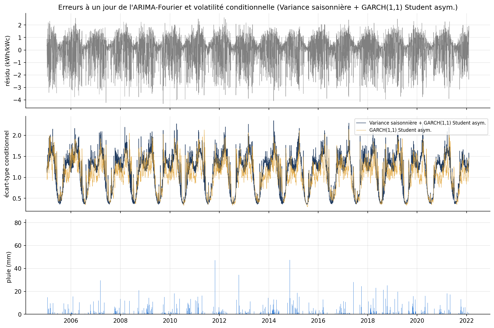{width=14cm}

# 5. Modélisation avancée

## 5.1 LSTM et GRU

**Mise en forme.** Fenêtres glissantes de L jours passés (production, nébulosité, température, humidité, pluie, aérosols, position dans l'année), prévision directe des 7 jours suivants. La cible est l'écart à la normale saisonnière (moyenne et écart-type par jour de l'année, calculés sur l'apprentissage) : le réseau part de la climatologie et n'apprend que l'écart. Normalisation avec les statistiques de l'apprentissage seulement. Deux jeux d'information : ex ante (date seulement) et ex post (météo observée des 7 jours).

{{TABLEAU_CV}}

- **Validation croisée temporelle** (*walk-forward* : trois plis à fenêtre croissante, écart de 7 jours, jamais de k-fold aléatoire) : les huit configurations sont à moins de 0,003 kWh/kWc les unes des autres, pour une dispersion entre plis de 0,02. Les hyperparamètres ne sont pas identifiables ; on retient une fenêtre de 14 jours et 64 unités, une couche, un dropout de 0,1 et un arrêt anticipé (la persistance de la météo étant d'un à deux jours, une fenêtre plus longue n'apporte rien).
- **Les réseaux apprennent peu ex ante :** la perte de validation reste plate dès les premières époques puis remonte, et l'arrêt anticipé retient la 3e époque pour le LSTM : le réseau prévoit presque la normale. Ex post, les deux courbes baissent ensemble jusqu'à un niveau deux fois plus bas.
- **Sensibilité à la graine :** écart-type du RMSE de 0,001 ex ante, de 0,005 à 0,014 ex post. LSTM et GRU sont équivalents ; le GRU a 20 % de paramètres en moins.

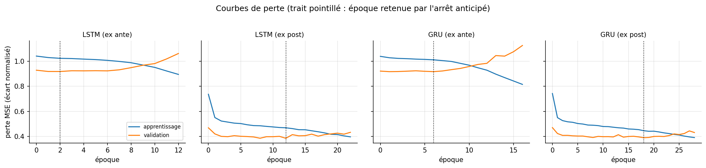{width=15cm}

## 5.2 Approche hybride

Un LSTM entraîné sur les erreurs à 7 jours de l'ARIMA-Fourier n'en explique que 0,8 % sur le test (RMSE de 1,085 contre 1,089) : sans information nouvelle sur la météo à venir, il ne reste presque pas de structure non linéaire. La limite vient de l'information disponible, pas de la classe de modèles.

## 5.3 Modèles additionnels

- **Prophet** (1,097) n'est qu'une climatologie lissée : il n'utilise pas les dernières observations.
- **XGBoost en prévision directe** (20 variables) : meilleur modèle ex ante à un jour (0,985). Son importance des variables confirme la section 3.7 : normale du jour visé, position dans l'année et rayonnement extraterrestre dominent ; la nébulosité du jour d'origine ne compte qu'à un jour.
- **LSTM global entraîné sur les 9 villes** (50 238 fenêtres, chaque ville ramenée à ses propres normales) : sur Tunis, 1,078 contre 1,082 pour le LSTM local, significativement meilleur à 7 jours. Le même réseau bat la climatologie dans les 9 villes, de 1,2 % à Tozeur (ciel le plus stable) à 3,8 % à Madrid.

# 6. Prévision et évaluation

**Protocole.** Pour chacune des 688 origines du test, chaque modèle prévoit les 7 jours suivants (h = 7) avec les paramètres de l'apprentissage et les seules observations disponibles à l'origine. Deux références : la persistance (demain comme aujourd'hui) et la climatologie (normale saisonnière du jour).

{{TABLEAU_METRIQUES}}

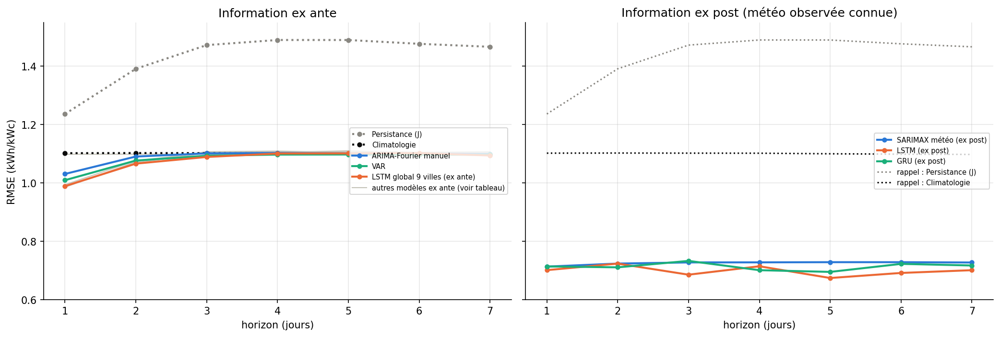{width=15cm}

- **Ex ante, tous les modèles se tiennent dans un mouchoir :** de 1,078 (LSTM global) à 1,097 (Prophet), contre 1,100 pour la climatologie et 1,434 pour la persistance. Le gain est concentré sur un ou deux jours (7 à 10 % à un jour) ; dès le troisième jour, tous les modèles rejoignent la normale : c'est la conséquence de l'AR(1) faible de la section 3.3.
- **Avec la météo observée, l'erreur baisse d'un tiers** et reste stable à tous les horizons. Borne optimiste : une vraie prévision météo est imparfaite.
- **MAPE de 30 %** pour la climatologie : il est gonflé par les journées très couvertes ; le WAPE (19 %) est plus représentatif.
- **Intervalles :** couverture moyenne de 95 % pour l'ARIMA, le VAR et le SARIMAX, mais 93,5 % de novembre à mars contre 95,9 % d'avril à octobre pour l'ARIMA (92,6 % et 96,8 % pour le SARIMAX) : c'est le défaut de variance constante de la section 4.3.

{{TABLEAU_COMPLEXITE}}

{{TABLEAU_DM}}

- **À un jour,** tous les modèles sauf Prophet battent significativement la climatologie. **À sept jours, aucun modèle ex ante ne la bat** ; le LSTM local fait même significativement moins bien (p = 0,005). Les modèles ex post la battent à tous les horizons.
- **Le LSTM global** est significativement meilleur que l'ARIMA et le VAR à un jour, pas à sept jours ; meilleur que le LSTM local à sept jours seulement : les autres villes régularisent.
- **Ex post,** le LSTM n'est pas significativement meilleur que le SARIMAX météo en perte quadratique (p = 0,32 à un jour) ; il l'est en perte absolue.

**Conclusion sur le meilleur modèle selon le cas d'usage.**

- **Sans prévision météo :** au-delà de deux jours, rien ne bat la normale saisonnière. À un ou deux jours, le **VAR** est recommandé : un peu moins précis que le LSTM global (1,009 contre 0,989 à un jour), il est interprétable, fournit un intervalle calibré et s'ajuste en une demi-seconde.
- **Avec une prévision météo :** le **SARIMAX météo** pour un exploitant qui doit justifier ses décisions (effet chiffré des nuages, de la pluie et des poussières, intervalle calibré), le LSTM ex post si seule compte la précision (-3,6 % de RMSE).

**Vérification croisée R et Python.**

{{TABLEAU_R_PYTHON}}

Les RMSE sont identiques pour la persistance, la climatologie et le VAR, et diffèrent de 0,15 % au plus pour les ARIMA (algorithmes d'estimation différents). Les deux langages retiennent le même modèle.

# 7. IA générative et LLM

## 7.1 Protocole

- **LLM utilisé :** `qwen3-vl:8b-instruct`, modèle généraliste exécuté en local avec Ollama, température 0 et graine fixée (réponses reproductibles).
- **Prompts :** construits par le notebook à partir de ses propres sorties (`llm/prompt_1.txt` à `prompt_3.txt`), pour que chaque affirmation du LLM soit vérifiable ; réponses archivées intégralement (annexe A).
- **Interprétation humaine d'abord :** notre propre lecture (`llm/interpretation_experte.md`, annexe A.1) a été rédigée avant l'envoi des prompts ; le script d'interrogation refuse de s'exécuter sans elle.
- **Le même LLM sert l'assistant RAG** (section 8.3), mais ancré sur des passages retrouvés et obligé de citer ses sources.

[À compléter par le groupe : préciser les autres outils d'IA générative utilisés pour le code et la rédaction, et à quelles étapes.]

## 7.2 Hypothèses de modèles (prompt 1)

Le LLM n'a reçu que les statistiques descriptives, les autocorrélations et les tests de stationnarité.

| Point | Réponse du LLM | Notre analyse | Verdict |
|---|---|---|---|
| Cycle annuel | SARIMA(1,1,1)(1,1,1)**12** et décomposition de Fourier | Fourier (K = 2) ; s = 12 seulement à la maille mensuelle | convergence sur Fourier, **erreur de période** |
| Différenciation | d = 1 et D = 1 | d = 0 et D = 0 | **erreur** : tests lus à l'envers |
| Tendance | « tendance visible » | aucune (moins de 1 % de la variance) | **invention** |
| Variance | GARCH | variance saisonnière + GARCH | convergence partielle |
| Variables exogènes | SARIMAX avec la météo | SARIMAX météo | convergence |
| Transformation | aucune | aucune | même conclusion, justification fausse |
| Structure de court terme | non vue | AR(1) de 0,26 | oubli |

**Erreurs relevées.**

- **Tests lus à l'envers.** Le LLM écrit que « la série originale est non stationnaire (ADF p = 0.0, KPSS p = 0.10) ». Une p-value nulle à l'ADF rejette la racine unitaire et une p-value de 0,10 au KPSS ne rejette pas la stationnarité : les deux tests disent l'inverse. Suivre sa recommandation (d = 1) produirait la sur-différenciation que montre l'ACF de la série différenciée (-0,37 au retard 1).
- **Période saisonnière fausse.** Un SARIMA de période 12 sur une série journalière ne représente aucun cycle réel ; le cycle annuel a une période de 365 jours.
- **Chiffres et propriétés inventés.** « Corrélation > 0,5 » entre la météo et la production, séries « stationnaires après différenciation » : rien de tel ne figurait dans le prompt. La « tendance visible » vient d'une mauvaise lecture du nom d'une ligne du tableau (« désaisonnalisée, avec tendance » désigne la spécification du test, pas un résultat).
- **Raisonnement contradictoire.** Il écarte la transformation parce que « la variance n'est pas fortement hétéroscédastique (écart-type = 1,402) », alors qu'un écart-type global ne dit rien de l'hétéroscédasticité et qu'il propose un GARCH deux paragraphes plus haut, en citant lui-même un écart-type de 0,41 en juillet contre 1,25 en janvier.
- **Pièges non vus :** l'irradiation PVGIS, citée parmi les séries associées, est tautologique ; le MAPE est instable pour les journées très sombres ; les données sont simulées.

## 7.3 Vulgarisation pour un décideur (prompt 2)

Le texte est clair, court, et reprend correctement les erreurs du tableau (0,699 et 0,725 kWh/kWc). Il explique bien pourquoi la persistance échoue (la météo change). Mais :

- **Erreur principale : il recommande un modèle inutilisable tel quel.** Le LLM conseille le LSTM ex post « quand vous avez les données météo avant la production ». Le prompt définissait « ex post » comme la météo réellement observée, qui n'existe pas au moment de la prévision. Avec une vraie prévision météo, l'erreur serait plus forte (entre 0,70 et 1,08). C'est l'erreur la plus dangereuse pour un décideur, parce qu'elle est formulée avec assurance.
- **Qualificatifs sans preuve :** précision « exceptionnelle » (0,70 kWh/kWc pour une moyenne de 4,48, soit 16 % : bonne, pas exceptionnelle), modèle « plus robuste », qui « fonctionne bien même en hiver ». Aucun résultat saisonnier du LSTM n'était fourni, et le prompt précisait au contraire que l'incertitude est plus forte en hiver.
- **Oublis :** que les modèles sans météo font à peine mieux que la normale saisonnière ; que le SARIMAX, presque aussi précis, explique ses prévisions (effet des nuages et des poussières, fourni dans le prompt) et donne un intervalle.

## 7.4 Recommandations de gestion (prompt 3)

Le LLM devait formuler lui-même les limites de ses recommandations.

| Recommandation du LLM | Limites qu'il formule | Notre complément critique |
|---|---|---|
| Planifier le nettoyage avec les prévisions ex post (« météo observée »), en janvier et novembre | données simulées ; nettoyage inutile ou tardif | Impossible : la météo observée n'est connue qu'après coup. « Janvier, novembre » relève de la climatologie, pas d'un modèle. PVGIS ne modélise pas la salissure (pertes fixes de 14 %) : nos données ne disent pas quand nettoyer. |
| Piloter la batterie avec le LSTM ex ante, jusqu'à 7 jours | MAPE élevé, surtout en hiver | Juste sur l'hiver, mais il ne voit pas que ce modèle fait à peine mieux que la normale (MAE de 0,83 contre 0,86), et pas mieux du tout au-delà de deux jours. |
| S'engager auprès du réseau avec le modèle ex post et un « seuil de confiance de 90 % » | dépend de la météo observée | Même confusion sur l'ex post. Le seuil de 90 % de la prévision est arbitraire alors que des intervalles calibrés par saison existent (section 4.3). |
| Informer les usagers avec une marge de ± 15 % | données simulées ; perte de confiance | ± 15 % reprend le MAPE du modèle ex post : un MAPE n'est pas la demi-largeur d'un intervalle. Il faut l'intervalle du modèle ex ante, plus large l'hiver. |

**Limites qu'il formule bien :** installation réelle non validée, dégradation physique des modules non modélisée, rentabilité non étudiée. **Hors sujet :** la neige à Tunis. **Oubli essentiel :** les résultats ex post ne mesurent pas ce que donnerait une vraie prévision météo, et c'est pourtant la condition de toutes ses recommandations.

## 7.5 Comparaison avec notre interprétation

| | Notre interprétation (rédigée avant) | LLM |
|---|---|---|
| Différenciation | d = 0, cycle par Fourier | d = 1, D = 1, période 12 |
| Variance | saisonnière, puis GARCH | GARCH |
| Modèle recommandé sans météo | VAR à 1-2 jours, normale au-delà | LSTM ex ante « jusqu'à 7 jours » |
| Modèle recommandé avec météo | SARIMAX météo alimenté par une vraie prévision | LSTM ex post « météo observée » |
| Statut de l'ex post | borne optimiste, non opérationnelle | traité comme opérationnel |
| Message clé | au-delà de 2 jours, rien ne bat la normale | absent |
| Intervalles | calibrés par saison | marge arbitraire de ± 15 % |
| Données simulées | limite principale | limite bien relevée |

Table: Convergences et divergences entre l'analyse humaine et le LLM.

Le LLM converge avec nous sur ce qui se voit à la lecture : la météo est la variable décisive, l'hiver est plus incertain, les données sont simulées, la variance doit être modélisée. Il diverge sur tout ce qui demande d'interpréter un test, de respecter une définition ou de comparer deux chiffres. Ses erreurs sont de trois natures : **hallucinations statistiques** (tests lus à l'envers, corrélations inventées), **causalités et qualités non démontrées** (« robuste », « fonctionne bien en hiver »), et **oubli des définitions du prompt** (ex post).

## 7.6 Bilan

- **Ce que le LLM a apporté :** une première liste d'hypothèses et un texte lisible en moins d'une minute chacun, et deux limites que nous n'avions pas formulées explicitement (dégradation des modules, rentabilité). C'est un brouillon et une liste de contrôle, pas une analyse.
- **Ce qu'il n'a pas su faire :** lire correctement deux tests de stationnarité, garder la définition d'« ex post » d'un bout à l'autre, voir qu'un MAE de 0,83 contre 0,86 n'est pas un gain, distinguer un MAPE d'un intervalle.
- **Ce qui marche mieux :** dans l'assistant RAG (section 8.3), un LLM ne répond qu'à partir de passages retrouvés (sur 16 questions de test, le bon passage figure toujours parmi les quatre transmis au LLM) et cite ses sources : chaque chiffre de sa réponse est vérifiable d'un clic.

# 8. Extensions

Deux des trois extensions proposées par l'énoncé sont traitées : les variables exogènes (météo, aérosols, grandeurs astronomiques : sections 3.7, 4.1 et 5) et la corrélation dynamique (8.1). La troisième, la détection d'événements par embeddings de texte, n'a pas été réalisée : la série étudiée est une simulation physique à puissance installée constante, sans rupture liée à l'actualité, et nous ne disposons pas d'un corpus d'actualités daté qui lui corresponde.

## 8.1 Corrélation dynamique entre pays

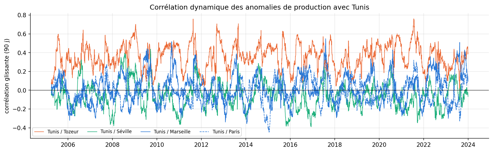{width=14cm}

Le même jour, Tunis et Tozeur (370 km) partagent une partie de leur météo (corrélation de 0,28 en hiver à 0,40 en été) ; avec Séville, Marseille et Paris, la corrélation fluctue autour de zéro. Un portefeuille d'installations réparti entre les trois pays lisserait donc fortement la production journalière. La corrélation glissante varie beaucoup : les épisodes communs sont ponctuels, ce qu'une corrélation statique masquerait.

## 8.2 Validation externe des données PVGIS

Une fois retirée la croissance du parc (division par la moyenne glissante sur 365 jours), la moyenne des trois villes PVGIS suit la production nationale mesurée avec une corrélation journalière de **0,91 en France** et de **0,87 en Espagne** (2016-2023). Les données satellitaires de tout le projet décrivent donc bien le terrain. La corrélation espagnole baisse en 2023 (0,72) ; deux hypothèses, non tranchées par nos données : croissance très rapide du parc cette année-là et écrêtement de la production aux heures de prix bas.

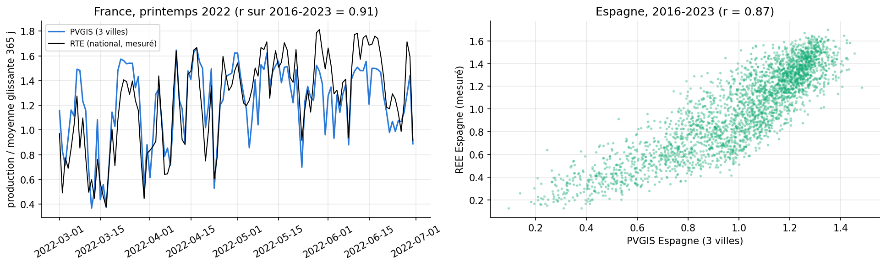{width=14cm}

## 8.3 Application web et assistant RAG

Une application (FastAPI et React, non demandée par l'énoncé) met les modèles à disposition. La page d'accueil est un formulaire : ville et pays, grandeur (production ou éclairement), modèle (LSTM global, ARIMA-Fourier, climatologie, persistance), date d'origine, horizon de 1 à 10 jours, puissance installée et consommation, et **les 14 derniers jours observés, pré-remplis et modifiables** : l'utilisateur peut y saisir les relevés de sa propre installation, y compris au-delà de 2023. La réponse donne la prévision, un intervalle (empirique pour le LSTM), l'écart à la normale, l'erreur moyenne du modèle sur le test, et un texte rédigé. Les modèles servis sont réentraînés sur les 9 villes (script `python/entrainer_modeles_app.py`) : RMSE moyen à 1-7 jours de 1,159 kWh/kWc pour le LSTM global, 1,162 pour l'ARIMA, 1,181 pour la climatologie.

L'assistant est un **RAG simple** : recherche BM25 dans un corpus de 236 passages (fiches des jeux de données, fiches statistiques par ville calculées sur les données, résultats de l'étude, texte de ce rapport, méthode PVGIS, glossaire, résumés des articles du rapport SolarVision), puis rédaction par un LLM hébergé (API Groq, modèle `openai/gpt-oss-120b`, température 0) avec citation des sources ; sans clé ou sans réseau, la réponse est extractive. Une question de prévision (« combien produira 3 kWc à Tunis les 5 prochains jours ? ») déclenche le LSTM et transmet sa prévision au LLM. L'ensemble se lance avec `docker compose up --build`.

{{TABLEAU_RAG}}

Avec la rédaction par le LLM (`resultats/rag_evaluation_llm.csv`), les 16 réponses citent leurs sources et sont exactes à la relecture ; le mot-clé attendu figure dans 15 d'entre elles (la seizième donne « 1 585 kWh par an » là où l'on attendait « kWh/kWc »). Deux réserves. Les synonymes du moteur ont été réglés sur ces mêmes questions : ces taux sont donc optimistes pour des questions nouvelles. Et à la question du meilleur modèle sans météo, le LLM répond « LSTM global, modèle recommandé » : le RMSE cité est juste, mais notre recommandation (section 6) est le VAR, pour son interprétabilité ; le LLM confond le plus petit RMSE et le meilleur choix.

# 9. Discussion critique

## 9.1 Limites des modèles et des données

- **Données simulées.** Le rayonnement est estimé par satellite et la production simulée pour une installation théorique, sans pannes, ombrages locaux ni salissures variables ; la validation externe (r = 0,91 et 0,87) rassure sur la météo, pas sur le comportement d'une installation réelle. Les trous de la base satellitaire ont dû être corrigés.
- **Ex post n'est pas une prévision.** Les modèles ex post utilisent la météo observée ; avec une vraie prévision météo, leur erreur se situerait entre 0,70 et 1,08 kWh/kWc, et seule une évaluation avec des prévisions archivées le dirait.
- **Hypothèses violées.** Résidus non gaussiens et asymétriques : les intervalles gaussiens sont approximatifs ; la variance n'est bien décrite qu'après retrait de sa composante saisonnière. La nébulosité ERA5 est une réanalyse et situe mal certains nuages.
- **Faible prévisibilité intrinsèque.** L'AR(1) de 0,26 borne ce que tout modèle ex ante peut faire : les écarts entre modèles (moins de 2 %) sont faibles devant l'incertitude, et les réseaux n'ont rien pu apprendre de plus. Le choix entre modèles se fait donc sur l'interprétabilité, le coût et les intervalles.
- **Une seule période de test** (2022-2023) et une seule ville principale ; le LSTM global et le tableau par ville de l'application montrent toutefois que les conclusions valent pour les huit autres villes.
- **Tendance non interprétée.** La légère hausse de la production (+0,2 % par an) n'est pas distinguable d'une dérive du capteur satellitaire.

## 9.2 IA générative et séries temporelles : avantages et inconvénients

**Avantages.**

- **Accélérer les tâches périphériques :** liste d'hypothèses, reformulation pour un non-spécialiste, documentation, squelette de code de collecte. Le gain de temps est réel tant qu'un humain vérifie.
- **Relecteur naïf :** ses contresens (lecture des tests, statut de l'ex post) montrent où une définition doit être rendue explicite pour un lecteur non statisticien.
- **Interface en langage naturel sur des résultats complexes :** un RAG ancré sur nos propres fiches et résultats permet d'interroger l'étude (« quelle ville produit le plus en hiver ? ») avec des sources vérifiables, et de déclencher un modèle de prévision à partir d'une question.
- **Données textuelles :** résumés d'articles, actualités ou rapports pourraient servir à détecter des événements (épisodes de poussières, pannes) et à les relier aux ruptures des séries.

**Inconvénients.**

- **Hallucination statistique :** p-values lues à l'envers, chiffres inventés, qualités attribuées sans preuve. Le danger vient de l'assurance du ton : rien ne distingue, dans la forme, une affirmation vraie d'une affirmation fausse.
- **Cohérence logique faible :** le LLM optimise la plausibilité du discours, pas le respect des définitions ; il peut se contredire d'un paragraphe à l'autre.
- **Pas de sens des ordres de grandeur sans calcul explicite :** un écart de 0,03 kWh/kWc n'est pas reconnu comme négligeable ; un MAPE devient une marge d'erreur.
- **Reproductibilité et versions :** température 0 et graine fixées ici, mais la réponse dépend du modèle et de sa version ; un modèle local de 8 milliards de paramètres (section 7) est moins capable qu'un grand modèle hébergé, en échange de données qui restent sur la machine. À l'inverse, l'assistant RAG passe par une API hébergée : réponse en une seconde, mais la question et les passages quittent la machine, et le service dépend d'une clé et d'un quota.
- **Responsabilité :** un texte de LLM recopié sans relecture engage son auteur sur des erreurs qu'il n'a pas vues.

**Bonnes pratiques retenues :** rédiger sa propre interprétation avant ; fournir les chiffres dans le prompt ; demander au LLM de formuler les limites, puis les compléter ; vérifier chaque nombre et chaque test cité ; ancrer les réponses par récupération de passages avec citation des sources ; ne jamais laisser le LLM choisir seul le modèle à déployer.

# 10. Conclusion

La production photovoltaïque journalière de Tunis se prévoit à un ou deux jours un peu mieux que la normale saisonnière (7 à 10 % à un jour), mais pas au-delà : une fois le cycle annuel retiré, la météo d'un jour ne renseigne presque pas sur celle de la semaine suivante. La météo à venir est la variable décisive : elle réduit l'erreur d'un tiers, et c'est la qualité de la prévision météo qui limitera tout système opérationnel. Les réseaux de neurones, même entraînés sur neuf villes, n'apportent qu'un gain marginal ; un VAR ou un SARIMAX bien diagnostiqués font presque aussi bien en restant lisibles et en fournissant des intervalles calibrés, à condition de modéliser la variance saisonnière des erreurs.

Pour le projet SolarVision, l'apport est concret : un productible fiable par ville (1 585 kWh/kWc/an à Tunis, soit 142 m² et non 156 pour 45 MWh/an), 14 jeux de données documentés et une application qui transforme la surface détectée par la vision en production attendue jour par jour.

**Prolongements.** Évaluer les modèles avec des prévisions météo archivées ; passer au pas horaire, où les réseaux ont davantage de données ; ajouter les mesures d'une installation réelle à Tunis ; relier l'application au module de segmentation de toitures de SolarVision.

# Annexe A. Prompts et réponses du LLM (texte intégral)

Modèle : `qwen3-vl:8b-instruct` (Ollama, local), température 0, graine 42. Les erreurs relevées en section 7 sont laissées telles quelles.

## A.1 Interprétation experte rédigée avant les prompts

{{INTERPRETATION_EXPERTE}}

## A.2 Prompt 1 - hypothèses de modèles

```
{{PROMPT_1}}
```

**Réponse du LLM :**

{{REPONSE_1}}

## A.3 Prompt 2 - explication vulgarisée pour un décideur

```
{{PROMPT_2}}
```

**Réponse du LLM :**

{{REPONSE_2}}

## A.4 Prompt 3 - recommandations de gestion

```
{{PROMPT_3}}
```

**Réponse du LLM :**

{{REPONSE_3}}

# Annexe B. Reproductibilité

| Élément | Détail |
|---|---|
| Collecte | `python python/collecte_donnees.py` : liens du rapport, API (PVGIS, Open-Meteo, NASA POWER, RTE, REE), 14 jeux de données ; environ 20 minutes, réponses mises en cache dans `data/brut/` |
| Notebook Python | `mini_projet_python.ipynb` : sections 1 à 6, extensions et prompts ; environ 15 minutes une fois les données présentes |
| Notebook R | `mini_projet_R.Rmd` (et sa version HTML) : sections 1, 2, 3 et 6 ; environ 5 minutes |
| Section 4 et extensions | Python uniquement |
| Graine | 42 dans les deux langages ; PyTorch en mode déterministe, sur CPU |
| Application | `docker compose up --build` (http://localhost:8000), ou sans Docker : `python python/entrainer_modeles_app.py`, puis `uvicorn main:app` dans `app/backend` (frontend construit servi à la racine) |
| Assistant RAG | clé `GROQ_API_KEY` dans le fichier `.env` (modèle : `.env.example`) ; sans clé, réponse extractive |
| Versions Python | Python 3.14 ; statsmodels 0.15.0 ; pmdarima 2.1.1 ; arch 8.0.0 ; torch 2.12.1 ; prophet 1.5.0 ; scikit-learn 1.8.0 ; xgboost 3.1.3 |
| Versions R | R 4.6.0 ; forecast 9.0.2 ; urca 1.3-4 ; vars 1.6-1 ; tseries 0.10-63 ; FinTS 0.4-9 ; rugarch 1.5-6 |

| Étape | R | Python |
|---|---|---|
| ARIMA et régression à erreurs ARIMA | `forecast::Arima`, `auto.arima` | `statsmodels` `ARIMA`, `pmdarima.auto_arima` |
| Stationnarité | `tseries::adf.test`, `kpss.test` | `adfuller`, `kpss` |
| Diagnostic des résidus | `Box.test`, `jarque.bera.test`, `FinTS::ArchTest` | `acorr_ljungbox`, `jarque_bera`, `het_arch` |
| VAR et Granger | `vars::VAR`, test de Wald | `VAR`, `test_causality` |
| Cointégration et VECM | `urca::ca.jo`, `cajorls` | `coint_johansen`, `coint`, `VECM` |
| Volatilité | `rugarch` | `arch` |
| Diebold-Mariano | `forecast::dm.test` | fonction écrite dans le notebook |
