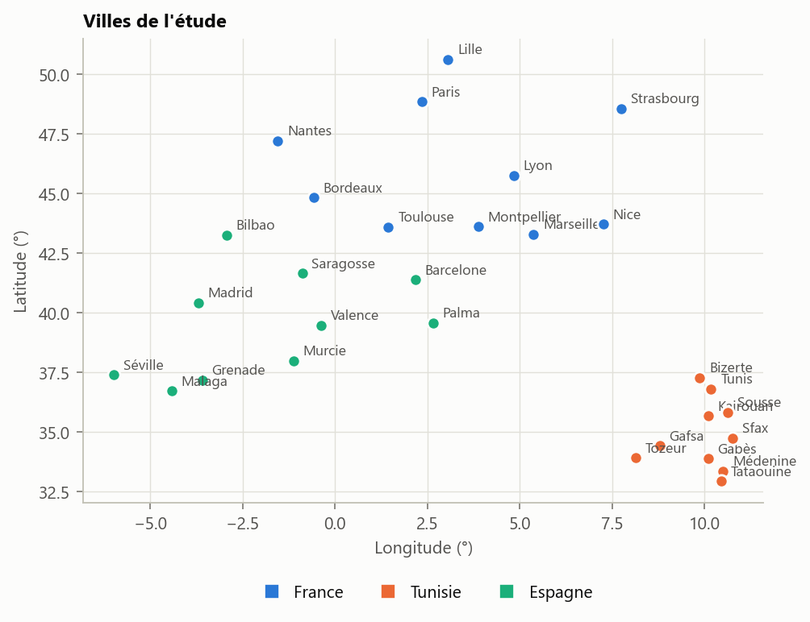
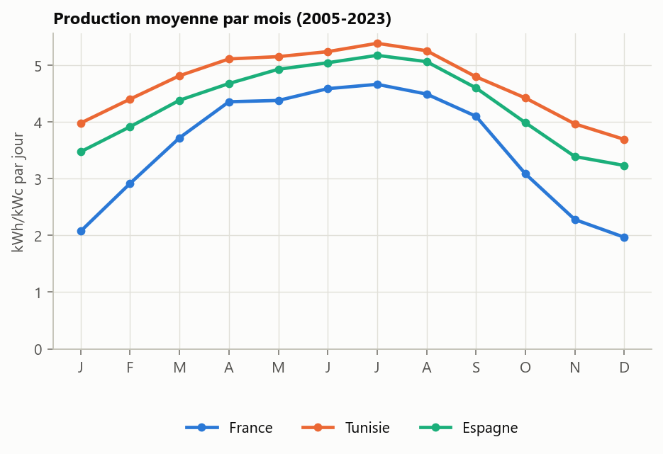
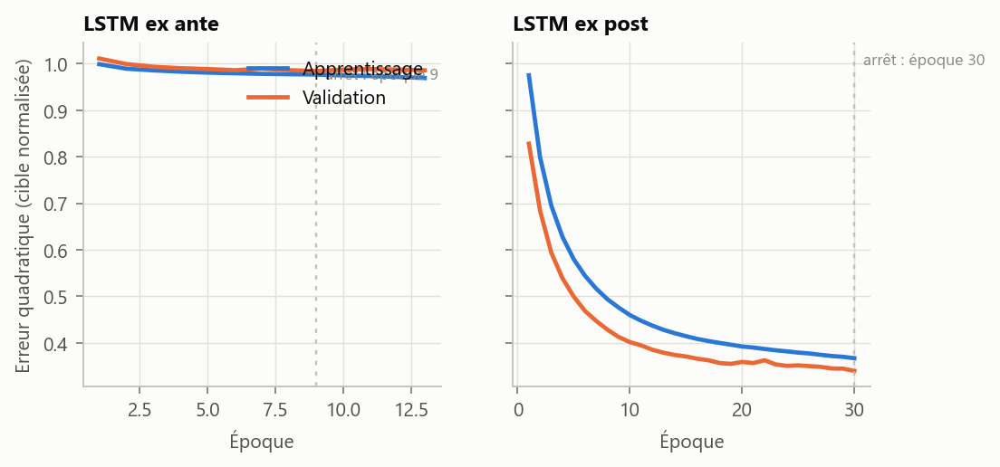
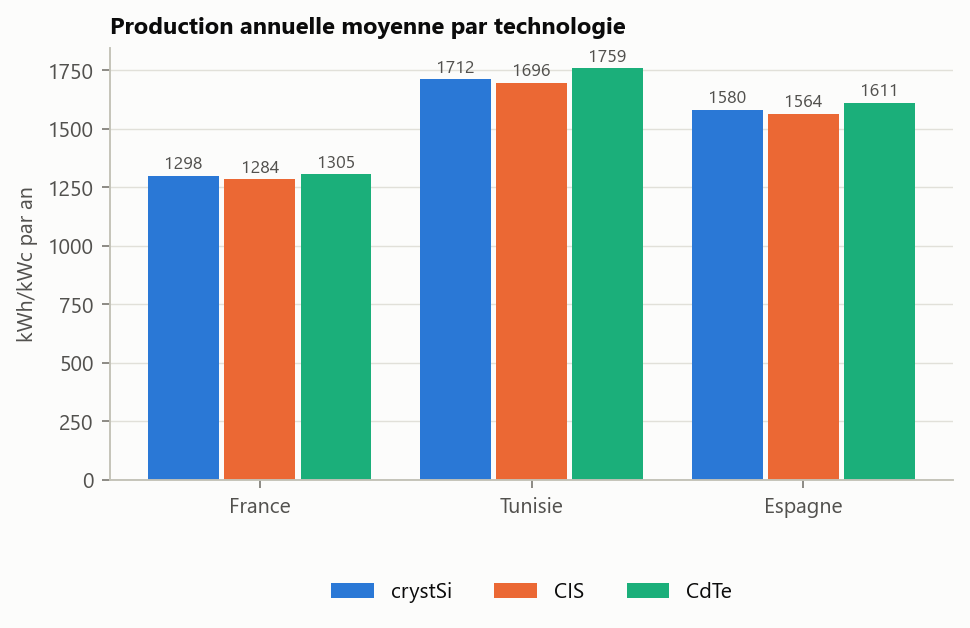
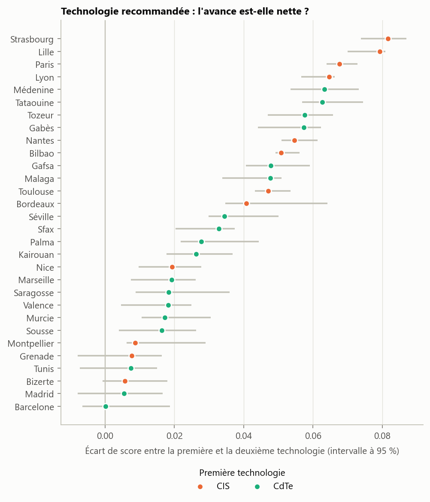
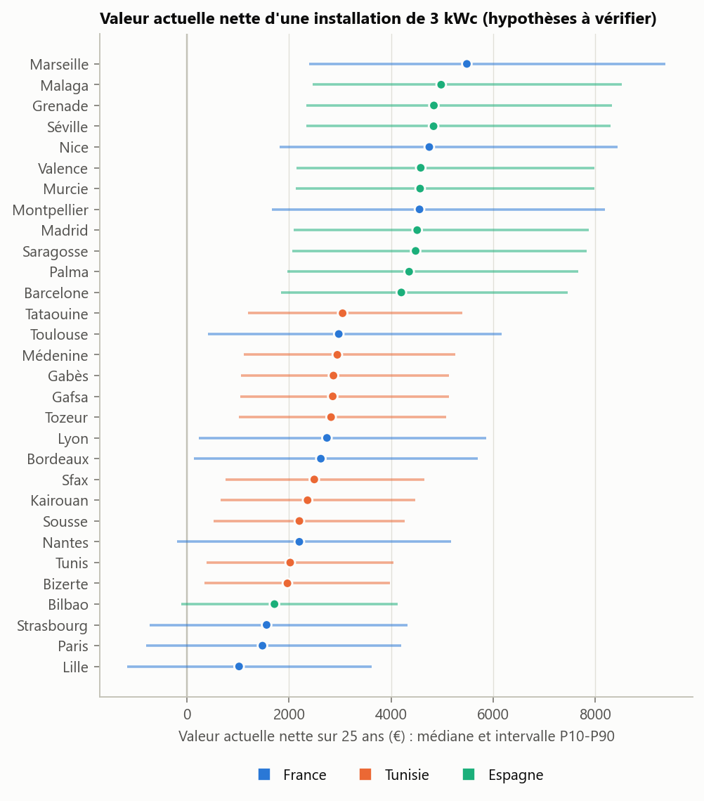
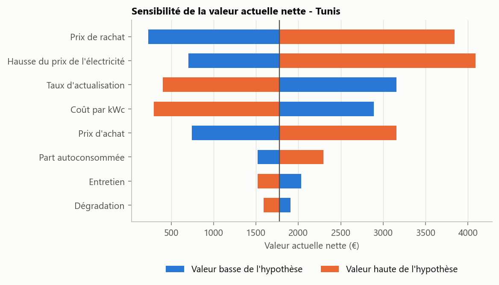
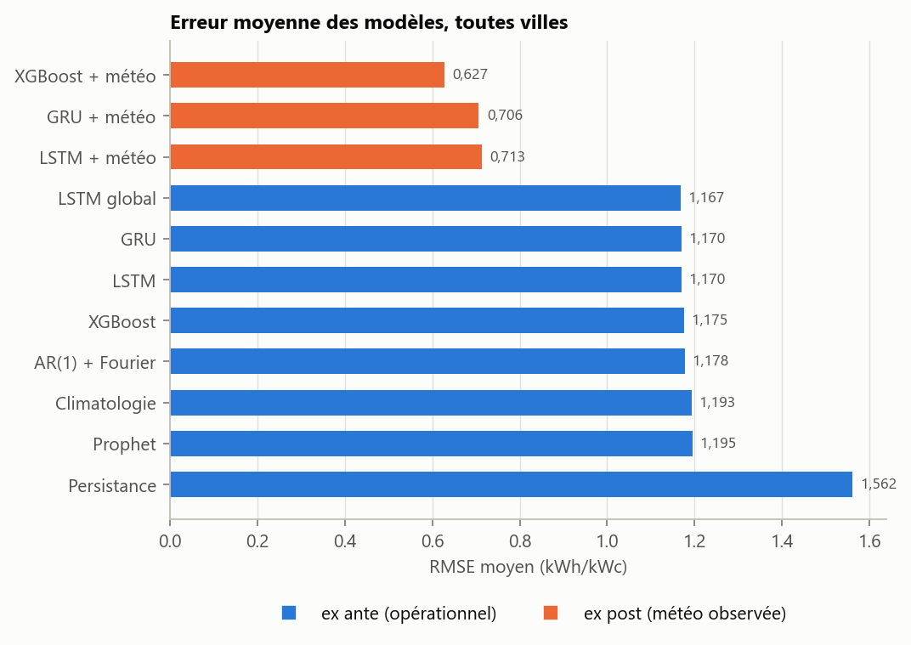
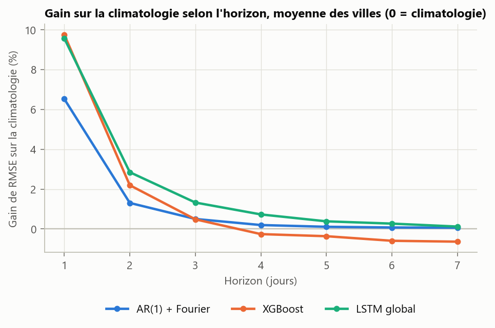
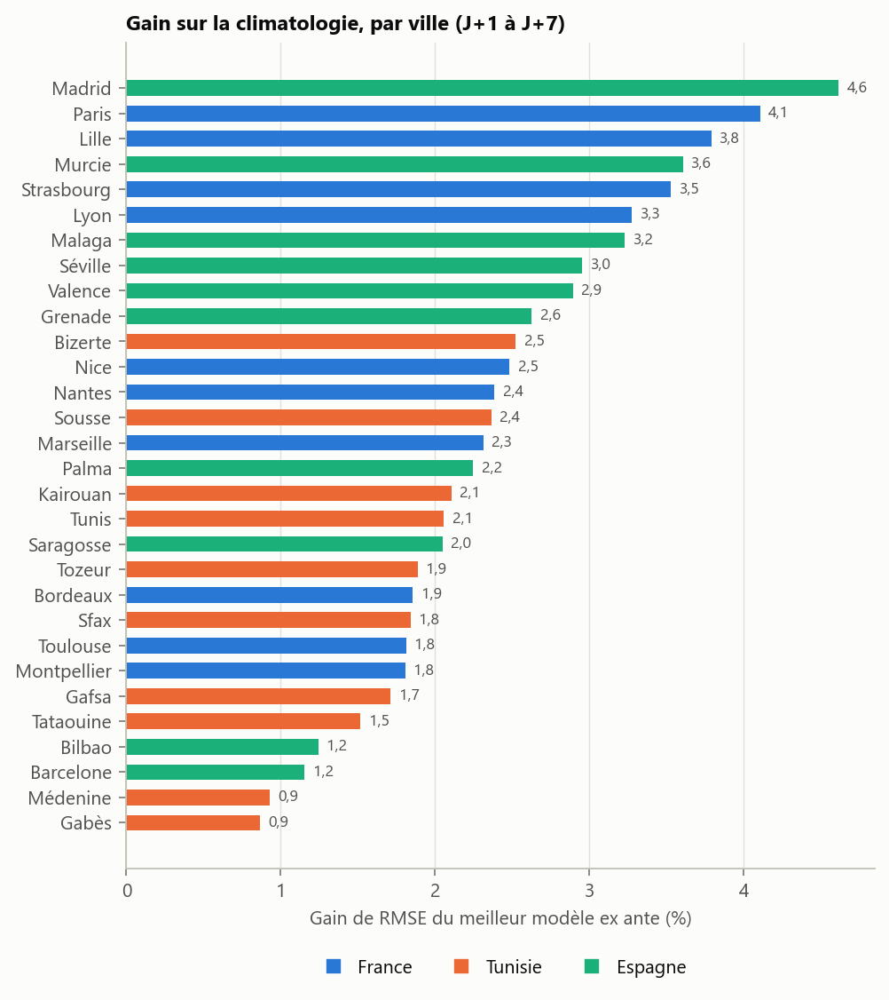

# 1. Introduction

**Thématique.** Nous avons retenu l'option B (environnement et énergie) et la production photovoltaïque journalière,
parce qu'elle pose un vrai problème de séries temporelles : une saisonnalité forte et connue à l'avance, à laquelle
s'ajoute une météo que rien, dans le passé de la série, ne permet de prévoir longtemps.

**Enjeu.** Un exploitant de toitures solaires doit connaître la production des jours suivants pour planifier
l'entretien, piloter une batterie ou s'engager auprès du réseau. Un architecte doit choisir une technologie de modules
et chiffrer ce qu'elle rapportera.

**Questions.**

- Peut-on prévoir de J+1 à J+7 la production journalière d'une installation de 1 kWc, et que gagne-t-on sur la simple normale saisonnière ?
- La réponse dépend-elle de la ville et du climat ?
- Quelle technologie de modules est la plus fiable dans chaque ville, et avec quelle certitude ?
- Que rapporte une installation, compte tenu de l'incertitude sur les prix ?

**Périmètre.** L'étude porte sur 30 villes (10 en Espagne, 10 en France, 10 en Tunisie),
de 2005 à 2023, soit 6 939 jours par ville, et sur
3 technologies (crystSi, CIS, CdTe).
Elle prolonge une première étude sur 9 villes, dont elle garde le socle classique détaillé sur Tunis.

**Démarche.** Chaque choix est justifié par un diagnostic. Tous les modèles sont comparés sur les mêmes dates de test,
avec les mêmes métriques et deux références naïves, et les écarts sont testés. Deux scénarios restent toujours séparés :
*ex ante*, où le modèle ne connaît rien du futur, et *ex post*, où il reçoit la météo observée des jours visés. Seul le
premier est une performance opérationnelle. Les résultats négatifs sont rapportés comme les autres.

**Plan.** Le chapitre 2 présente les données, le chapitre 3 leur exploration, les chapitres 4 et 5 les modèles classiques
et avancés. Les chapitres 6 et 7 traitent des technologies et de l'économie, le chapitre 8 de l'architecture. Le chapitre 9
porte sur l'IA générative, le chapitre 10 sur l'évaluation des prévisions, le chapitre 11 sur les limites.

# 2. Données et villes

## 2.1 Sources

| Source | Contenu | Fichiers | Volume (Mo) |
|---|---|---|---|
| PVGIS 5.3 (Commission européenne, JRC) | Puissance horaire d'1 kWc pour 3 technologies, éclairement, température, vent | 518 | 219 |
| Open-Meteo (réanalyse ERA5) | Nébulosité, pluie, humidité, pression, rafales | 30 | 14 |
| NASA POWER | Rayonnement de contrôle, indice de clarté, aérosols | 30 | 26 |

Table: Sources de données et volume du cache brut.

Toutes les sources sont publiques. PVGIS **simule** la production à partir du rayonnement mesuré par satellite
(base SARAH3) et de la météo ERA5 ; ce ne sont pas des mesures d'installations réelles. L'installation simulée est la
même partout : 1 kWc, plein sud, pente optimale du site, 14 % de pertes.
L'origine, la licence et l'empreinte SHA256 de chaque fichier sont dans `data/manifest.yaml`.

## 2.2 Villes

{width=11cm}

Les coordonnées de chaque ville ont été comparées à une référence indépendante (GeoNames) : aucune ne s'en écarte de plus de 2,0 km. Ajouter une ville revient à ajouter une ligne dans `configs/cities.yaml`.

| Pays | Villes | crystSi | CIS | CdTe |
|---|---|---|---|---|
| Espagne | 10 | 1 580 | 1 564 | 1 611 |
| France | 10 | 1 299 | 1 284 | 1 306 |
| Tunisie | 10 | 1 713 | 1 696 | 1 759 |

Table: Production annuelle moyenne par pays et par technologie (kWh/kWc/an).

## 2.3 Qualité et imputation

Chaque table compte 6 939 jours. Aucune valeur ne manque. PVGIS enregistre un rayonnement nul certains jours où l'image satellitaire manque : 11 à 15 jours par ville, soit 374 au total. 30 villes sur 30 passent tous les contrôles.

Un jour est corrigé si la hauteur du soleil donnée par PVGIS est inférieure de plus de 5° à la
hauteur astronomique à midi, ou si l'irradiation PVGIS vaut moins de 25 % de celle de
NASA POWER un jour où NASA POWER dépasse 1,5 kWh/m². La valeur corrigée est l'irradiation
NASA POWER du jour multipliée par le rapport médian PVGIS / NASA des 31 jours voisins. La même
correction s'applique aux trois technologies. Le jour reste signalé par la colonne `jour_impute_pvgis`. À Tunis, les 13 dates repérées sont exactement celles de la première étude, ce qu'un test automatique vérifie contre l'ancien jeu de données et non contre la règle elle-même.

## 2.4 Découpage

Le découpage est chronologique, sans tirage aléatoire : 6 245 jours d'apprentissage (du 2005-01-01 au
2022-02-05) et 694 jours de test (du 2022-02-06 au 2023-12-31). Le panel de
modélisation compte 208 170 lignes et 61 colonnes. Chaque colonne a un rôle déclaré : identifiant,
cible, variable ex ante ou variable ex post. Un test falsifie le futur et vérifie qu'aucune variable ex ante ne change.

# 3. Analyse exploratoire

## 3.1 Saisonnalité

{width=12cm}

La production suit un cycle annuel dans toutes les villes. À Tunis, la production moyenne vaut 4,29 kWh/kWc par jour, de 3,06 en décembre à 5,43 en juillet. Le rapport entre le meilleur et le moins bon mois va de
1,3 à Tozeur à 3,7 à Strasbourg : plus on
monte en latitude, plus l'hiver pèse.

## 3.2 Statistiques descriptives

| Pays | Moyenne | Variance | Skewness | Kurtosis (excès) | Été / hiver | Variance saisonnière (%) | Autocorrélation à 1 jour |
|---|---|---|---|---|---|---|---|
| Espagne | 4,32 | 2,20 | -1,00 | 0,20 | 1,6 | 22 | 0,34 |
| France | 3,54 | 3,16 | -0,25 | -0,97 | 2,6 | 32 | 0,32 |
| Tunisie | 4,68 | 1,35 | -1,39 | 1,90 | 1,5 | 26 | 0,24 |

Table: Statistiques de la production journalière sur l'apprentissage, moyennes par pays (kWh/kWc).

- **Asymétrie.** La distribution est asymétrique à gauche dans 26 villes sur 30 : la production est bornée par
  le ciel clair, et les journées couvertes tirent vers le bas.
- **Poids de la saison.** La normale saisonnière explique en moyenne 27 % de la
  variance journalière. Le reste est la météo de court terme, seule partie à prévoir.
- **Persistance faible.** Une fois la normale retirée, l'autocorrélation à un jour vaut en moyenne
  0,30 (de 0,21 à 0,43) et
  0,02 à sept jours. La météo d'un jour renseigne peu sur le lendemain et presque pas sur la
  semaine suivante : c'est ce qui limitera tous les modèles ex ante.

## 3.3 Stationnarité

Deux tests complémentaires sont appliqués à l'écart à la normale saisonnière de chaque ville. L'ADF a pour hypothèse nulle
une racine unitaire ; le KPSS a pour hypothèse nulle la stationnarité. L'ADF rejette la racine unitaire dans 30 villes sur
30 (seuil de 5 %) et le KPSS ne rejette pas la stationnarité dans 23 villes. Les deux tests s'accordent sur
23 villes. La série est donc traitée en niveau, sans différenciation, le cycle annuel étant porté par des termes
déterministes.

**Étude détaillée de Tunis.** L'exploration complète de la série de Tunis (graphiques, ACF et PACF de la série brute, différenciée et désaisonnalisée, décomposition STL, valeurs aberrantes) est dans le notebook historique `mini_projet_python.ipynb` et dans le notebook R. Sur la série brute, l'ADF vaut -5,84 (p = 0,000) et le KPSS 0,027 (p = 0,10) : conclusion « stationnaire », donc un ordre de différenciation d = 0.

# 4. Modélisation classique

## 4.1 ARIMA à termes de Fourier (Tunis)

L'ACF de la série désaisonnalisée décroît dès le premier retard et la PACF se coupe après lui : la signature d'un AR(1).
Une grille d'ordres p et q faibles, avec K harmoniques annuelles, est classée par BIC. Elle retient l'ordre (1, 0, 0)
avec K = 2 (BIC = 18 978), et la recherche automatique (`pmdarima`, `auto.arima` en R) confirme ce choix.

| Diagnostic des résidus | Valeur | Lecture |
|---|---|---|
| Ljung-Box à 10 retards (p) | 0,092 | pas d'autocorrélation restante |
| Jarque-Bera (p) | 0,000 | normalité rejetée |
| Skewness, kurtosis | -0,94 ; 3,71 | erreurs asymétriques à gauche |
| ARCH-LM à 7 retards (p) | 0,000 | variance non constante |

Table: Diagnostic de l'ARIMA à termes de Fourier, Tunis.

La structure d'autocorrélation est captée, mais deux hypothèses sont violées : les résidus ne sont pas gaussiens et leur
variance change avec la saison. Les intervalles gaussiens sont donc approximatifs (chapitre 10), et la variance fait l'objet
de la section 4.3. Un SARIMA saisonnier (s = 12) est ajusté sur la série mensuelle dans les deux notebooks.

## 4.2 VAR, causalité de Granger et cointégration (Tunis)

Un VAR en niveaux relie la production, la nébulosité et la température. Le BIC retient p = 3, l'AIC p = 3 ; le BIC,
plus parcimonieux, est suivi.

| Cause | Effet | F | p |
|---|---|---|---|
| pv_kwh_kwc | nebulosite_pct | 14,3 | 0,0000 |
| pv_kwh_kwc | t2m_moy_c | 19,3 | 0,0000 |
| nebulosite_pct | pv_kwh_kwc | 98,8 | 0,0000 |
| nebulosite_pct | t2m_moy_c | 6,5 | 0,0002 |
| t2m_moy_c | pv_kwh_kwc | 2,9 | 0,0336 |
| t2m_moy_c | nebulosite_pct | 4,4 | 0,0044 |

Table: Causalité de Granger deux à deux.

Le lien le plus fort va de nebulosite_pct vers pv_kwh_kwc (F = 98,8). La causalité de Granger
mesure une prévisibilité, pas une cause physique : les trois séries décrivent le même état de l'atmosphère.

Le test de Johansen rejette 3 hypothèses de rang sur 3 : le rang est plein, le système est stationnaire
en niveaux et la cointégration ne s'applique pas. Un VECM n'est donc pas justifié ici ; il est estimé à titre de vérification,
sur les productions nationales française et espagnole, dans les notebooks.

## 4.3 Volatilité conditionnelle (Tunis)

Le test ARCH-LM sur les erreurs de l'ARIMA rejette l'homoscédasticité (p = 0,000).
8 spécifications sont comparées ; le BIC retient « Variance saisonnière + GARCH(1,1) Student asym. ». Mais la volatilité estimée suit le calendrier : elle
est forte en hiver et faible en été. Un GARCH seul prend cette saisonnalité pour une persistance des chocs. La variante
« standardisés Variance saisonnière + GARCH(1,1) Student asym. » retire d'abord la variance saisonnière : ses résidus standardisés ne montrent plus d'effet ARCH
(p = 0,385).

## 4.4 Le même modèle dans toutes les villes

Le modèle identifié sur Tunis, une régression harmonique à erreurs AR(1), est estimé dans chaque ville et réestimé tous les
30 jours. Le coefficient AR(1) vaut en médiane 0,30, de
0,21 à Gafsa à 0,43 à Grenade. Partout, la mémoire de la série
est courte : l'écart à la saison observé un jour est divisé par 3,3 dès le lendemain.

**R et Python.** Le socle classique est codé dans les deux langages. Le dossier R est autonome : copié seul hors du projet, il
s'exécute de bout en bout et reproduit à l'identique les tableaux de l'étude d'origine.

# 5. Modélisation avancée

## 5.1 Réseaux récurrents

**Mise en forme.** Chaque réseau reçoit les 14 derniers jours (écart de la production à sa normale,
nébulosité, température, humidité, pluie, aérosols, position dans l'année) et prévoit d'un coup les sept jours suivants. La
cible est l'écart à la normale saisonnière, divisé par son écart-type : le réseau part de la climatologie et n'apprend que la
correction. La normalisation n'utilise que l'apprentissage. La dernière année de l'apprentissage sert à l'arrêt anticipé.

**Validation glissante.** Les hyperparamètres sont choisis sur l'apprentissage seul, par 3 plis à
fenêtre croissante : on entraîne sur le début, on mesure sur l'année suivante, puis on avance. Jamais de validation croisée
aléatoire, qui mélangerait le futur et le passé.

| Fenêtre (jours) | Unités | Dropout | RMSE moyen | Écart-type entre plis |
|---|---|---|---|---|
| 7 | 64 | 0,1 | 1,1000 | 0,0794 |
| 14 | 32 | 0,1 | 1,1009 | 0,0833 |
| 14 | 64 | 0,0 | 1,0998 | 0,0815 |
| 14 | 64 | 0,1 | 1,0991 | 0,0805 |
| 14 | 64 | 0,3 | 1,0995 | 0,0807 |
| 28 | 64 | 0,1 | 1,1019 | 0,0829 |

Table: Validation glissante du LSTM à Tunis (kWh/kWc).

Les configurations se tiennent à 0,0029 kWh/kWc les unes des autres, pour un écart-type entre plis de
0,0814 : les données ne permettent pas de les départager. On retient donc la configuration la plus simple qui ne
perd rien, une fenêtre de 14 jours, 64 unités et un dropout de 0,1.
Sur les mêmes plis, la climatologie obtient 1,1111.

{width=13cm}

Ex ante, la perte de validation cesse de baisser dès l'époque 9 : le réseau apprend peu au-delà
de la normale. Ex post, elle descend jusqu'à l'époque 30 et finit à
0,34 contre 0,98 : la météo des jours visés contient l'information
qui manquait.

## 5.2 Résultats

| Modèle | Scénario | RMSE moyen | Écart à la climatologie | Villes où il fait mieux |
|---|---|---|---|---|
| LSTM | ex ante | 1,1696 | -2,0 % | 29 / 30 |
| GRU | ex ante | 1,1695 | -2,0 % | 29 / 30 |
| LSTM global | ex ante | 1,1674 | -2,2 % | 30 / 30 |
| XGBoost | ex ante | 1,1753 | -1,5 % | 30 / 30 |
| Prophet | ex ante | 1,1952 | 0,2 % | 12 / 30 |
| LSTM + météo | ex post | 0,7127 | -40,3 % | 30 / 30 |
| GRU + météo | ex post | 0,7062 | -40,8 % | 30 / 30 |
| XGBoost + météo | ex post | 0,6274 | -47,4 % | 30 / 30 |

Table: Modèles avancés, moyenne des villes ; climatologie : 1,1934 kWh/kWc.

**LSTM global.** Un seul réseau est entraîné sur toutes les villes, chacune ramenée à sa propre normale ; un vecteur appris par
ville lui permet de s'adapter au climat local. Son RMSE moyen est de 1,1674 contre
1,1696 pour les réseaux entraînés ville par ville : mettre les villes en commun aide.

**Modèles additionnels.** XGBoost prévoit chaque horizon par un modèle séparé, à partir de variables ex ante (dernières
productions, météo de la veille, calendrier, normale). Prophet (1,1952) n'utilise pas les dernières
observations : c'est une climatologie lissée, et il ne peut pas faire mieux qu'elle à court terme.

**Ce qui n'est pas repris.** Le modèle hybride ARIMA + LSTM de la première étude n'a pas été étendu aux nouvelles villes. Il reste
dans le notebook historique, où son RMSE à Tunis était de 1,0847 contre 1,0892 pour l'ARIMA seul : sans
information nouvelle sur la météo à venir, il ne reste presque rien à apprendre des erreurs.

# 6. Technologies photovoltaïques

## 6.1 Trois technologies, cinq critères

PVGIS simule trois technologies de modules : le silicium cristallin (crystSi) et deux couches minces, CIS et CdTe. Pour chaque
ville et chaque technologie, cinq critères sont **calculés** à partir des données ; aucun n'est une appréciation.

| Critère | Poids | Sens |
|---|---|---|
| Erreur de prévision à 1-7 jours rapportée à la production (WAPE, %) | 0,25 | plus bas = mieux |
| Variabilité journalière, mensuelle et interannuelle de la production | 0,25 | plus bas = mieux |
| Baisse du ratio de performance quand la température monte (% par °C) | 0,15 | plus bas = mieux |
| Ratio de performance des jours peu ensoleillés rapporté à celui des jours très ensoleillés | 0,15 | plus haut = mieux |
| Production annuelle moyenne (kWh/kWc/an) | 0,20 | plus haut = mieux |

Table: Critères du score de fiabilité. Chaque critère est ramené entre 0 et 1 parmi les villes d'un même pays.

{width=12cm}

| Technologie | Production (kWh/kWc/an) | Erreur de prévision (WAPE, %) | Température (%/°C) | Faible irradiation | Variabilité journalière (%) |
|---|---|---|---|---|---|
| CIS | 1 515 | 22,4 | -0,53 | 1,025 | 31,0 |
| CdTe | 1 558 | 23,3 | -0,37 | 0,924 | 32,2 |
| crystSi | 1 530 | 22,4 | -0,61 | 1,017 | 31,1 |

Table: Indicateurs moyens par technologie, toutes villes.

La technologie qui produit le plus en moyenne est CdTe (1 558 kWh/kWc/an). Les écarts
restent de quelques pour cent : les trois technologies voient le même ciel.

## 6.2 Recommandation par ville

| Pays | CIS | CdTe |
|---|---|---|
| Espagne | 2 | 8 |
| France | 9 | 1 |
| Tunisie | 1 | 9 |

Table: Nombre de villes où chaque technologie obtient le meilleur score.

{width=13cm}

L'incertitude est mesurée en rééchantillonnant des années entières, ce qui garde la saison intacte. Quand l'écart entre les
deux premières technologies tient dans cette marge, le rapport le dit : **5 villes sur 30 sont ex æquo**.
Dans les 25 autres, la technologie recommandée garde la première place dans 100 % des rééchantillonnages en moyenne.
Le classement dépend aussi des poids : en les faisant varier, la technologie recommandée reste première dans
72 % des tirages en moyenne. Le tableau par ville, avec le deuxième choix et la
justification chiffrée, est dans `reports/tech_recommendation.csv` et dans l'application.

**Peut-on deviner la technologie à partir du climat ?** Un arbre de décision reçoit les caractéristiques de la ville (latitude, altitude, irradiation, températures, nébulosité, variabilité). Jugé ville par ville, chaque ville étant prédite par un modèle qui ne l'a pas vue, il retrouve la technologie recommandée dans 83 % des cas. Proposer partout la technologie la plus fréquente en retrouve 60 %. L'arbre fait donc mieux que cette règle simple, sur un échantillon qui reste petit.

## 6.3 Orientation

Pour la technologie recommandée de chaque ville, PVGIS simule trois orientations : plein sud à la pente optimale (l'installation
de toute l'étude), deux pans est et ouest inclinés à 10°, et une orientation dont la pente et
l'azimut sont optimisés ensemble.

| Pays | Est-ouest par rapport au sud (%) | Gain de l'azimut optimisé (%) |
|---|---|---|
| Espagne | -16,2 | 0,02 |
| France | -17,1 | 0,01 |
| Tunisie | -13,5 | 0,01 |

Table: Effet de l'orientation sur la production annuelle, moyenne par pays.

Une toiture à deux pans est et ouest produit de 13 % (Bizerte) à
19 % (Marseille) de moins que le plein sud. Optimiser l'azimut n'apporte presque
rien : l'azimut optimal s'écarte du sud de 5° au plus, pour un gain maximal de
0,05 %. Le plein sud à la pente optimale est donc un bon choix partout.

## 6.4 Limites

- Les productions sont des **simulations** : les écarts viennent des modèles de rendement de PVGIS, pas de mesures.
- La **dégradation** dans le temps et la **fiabilité mécanique** ne sont pas modélisées par PVGIS.
- Les poids du score sont un choix ; ils sont écrits dans `configs/reliability.yaml` et leur influence est mesurée.

# 7. Bénéfices économiques

> **Avertissement.** Aucune des hypothèses de ce chapitre n'est une donnée du projet. Tarifs, coûts et taux sont des ordres de
> grandeur à confirmer auprès des sources indiquées ; chacun est marqué `TODO_VERIFY` dans `configs/economics.yaml`. Les résultats
> sont indicatifs. Ce n'est pas un conseil financier.

## 7.1 Hypothèses

L'installation type fait 3 kWc et dure 25 ans. Chaque hypothèse est
donnée par trois valeurs (basse / centrale / haute).

| Pays | Prix d'achat (€/kWh) | Rachat du surplus (€/kWh) | Coût (€/kWc) | CO2 du réseau (g/kWh) |
|---|---|---|---|---|
| France | 0,19 / 0,22 / 0,27 | 0,04 / 0,08 / 0,13 | 1 500 / 2 000 / 2 600 | 30 / 55 / 80 |
| Tunisie | 0,05 / 0,08 / 0,12 | 0,03 / 0,06 / 0,10 | 800 / 1 100 / 1 500 | 420 / 480 / 560 |
| Espagne | 0,12 / 0,17 / 0,24 | 0,03 / 0,06 / 0,10 | 1 100 / 1 400 / 1 900 | 120 / 170 / 230 |

Table: Hypothèses par pays, à vérifier (basse / centrale / haute).

Sources à confirmer : France : Tarif réglementé de vente et arrêté tarifaire EDF OA (CRE) ; base carbone ADEME ; Tunisie : Tarifs basse tension de la STEG et régime de comptage net ; ANME (PROSOL Elec) ; Espagne : PVPC (Red Eléctrica) et compensation simplifiée des excédents (RD 244/2019) ; MITECO.
S'y ajoutent la part autoconsommée (0,25 / 0,40 / 0,70), le taux d'actualisation
(2 / 4 / 7 %), la hausse annuelle du prix de l'électricité
(0 / 2 / 5 %), l'entretien et, par technologie, un surcoût et une dégradation annuelle.

## 7.2 Résultats

Une simulation de Monte-Carlo (5 000 tirages) tire chaque hypothèse dans sa plage et le productible
parmi les années observées. Aucun résultat n'est donné sans intervalle.

| Pays | VAN P10 (€) | VAN P50 (€) | VAN P90 (€) | Temps de retour P50 (ans) | Coût de l'énergie P50 (€/kWh) | CO2 évité P50 (t) | Probabilité VAN > 0 (%) |
|---|---|---|---|---|---|---|---|
| Espagne | 2 113 | 4 542 | 7 937 | 8,4 | 0,077 | 19,6 | 99 |
| France | 181 | 2 684 | 5 785 | 11,6 | 0,136 | 4,9 | 89 |
| Tunisie | 887 | 2 660 | 4 867 | 9,5 | 0,055 | 59,4 | 97 |

Table: Résultats médians par pays, technologie crystSi, installation de 3 kWc.

{width=13cm}

Les intervalles sont larges : l'incertitude sur les prix domine celle sur le soleil. Entre technologies, l'écart de valeur
actuelle nette n'est pas concluant dans 29 villes sur 30 (la première technologie gagne dans moins de
90 % des tirages), parce que le surcoût des couches minces est lui-même mal connu.

{width=12cm}

À Tunis, l'hypothèse qui pèse le plus est le prix de rachat (amplitude de 3 614 €),
devant la hausse du prix de l'électricité (3 385 €). Ce sont les premières valeurs à vérifier.

## 7.3 Valeur de la prévision

Que vaut une meilleure prévision ? Le modèle de coût est explicite : chaque kWh d'écart entre le plan et la production réelle
coûte une pénalité, tirée entre 0,01 et 0,06 €/kWh.
Remplacer la climatologie par le meilleur modèle ex ante évite en médiane 36 kWh d'erreur par an
pour 3 kWc, soit un gain médian de 1,17 € par an
(de 0,72 à 1,72 €). Pour une installation résidentielle, ce gain est
négligeable : la prévision ex ante ne prend de la valeur qu'à l'échelle d'un parc, ou associée à une prévision météo.

# 8. Architecture et MLOps

## 8.1 Organisation

Le code est un paquet Python installable (`src/solarvision/`). Chaque étape est une commande de `python -m solarvision.cli` :
`ingest`, `features`, `train`, `deep`, `evaluate`, `recommend`, `economics`, `register`, `monitor`, `serve`, `report`. La commande
`pipeline` les enchaîne ; l'option `--fast` les limite à trois villes pour les essais.

| Je cherche | Emplacement |
|---|---|
| Villes, paramètres, hypothèses | `configs/` |
| Réponses brutes des API | `data/raw/<source>/<ville>/` |
| Tables traitées, panel, découpages | `data/processed/` |
| Origine, licence, empreinte de chaque fichier | `data/manifest.yaml` |
| Prévisions date par date | `reports/forecasts/` |
| Métriques, tests, recommandations | `reports/` |
| Modèles et version en production | `models/registry/` |

Table: Où trouver quoi.

## 8.2 Pratiques appliquées

- **Reproductibilité.** Graine fixée, configuration hors du code, cache brut jamais réécrit, reprise après interruption.
- **Contrats de données.** Un schéma Pandera par table ; une table invalide n'est jamais écrite.
- **Tests.** Données, anti-fuite temporelle, tests statistiques comparés à R, économie, registre, API, non-régression des métriques.
- **Suivi d'expériences.** Chaque version de modèle est journalisée dans MLflow avec ses paramètres, ses métriques, le commit et la graine.
- **Registre et promotion.** Un modèle ne passe en production que s'il bat la climatologie **et** la version en place, sur les mêmes
  dates de test. Le retour arrière tient en une commande. L'empreinte SHA256 est vérifiée à chaque chargement.
- **Service.** Une API versionnée (`/v1`) renvoie les prévisions avec leur intervalle et journalise chaque requête.

## 8.3 Registre

| Modèle | Version | RMSE moyen | RMSE climatologie | Villes gagnées | Statut |
|---|---|---|---|---|---|
| AR(1) + Fourier | 1.0.0 | 1,1777 | 1,1934 | 30 | enregistré |
| LSTM global | 1.0.0 | 1,1674 | 1,1934 | 30 | production |

Table: Versions enregistrées.

Le modèle en production est **LSTM global**, version 1.0.0.

## 8.4 Suivi

Entre l'apprentissage et le test, 173 couples ville-variable sont stables, 22 à surveiller et 15 en alerte (indice de stabilité de population). L'erreur du modèle en production dépasse de plus de 20 % celle de la climatologie pendant 0,2 % des jours.
La dérive est mesurée sur l'écart à la moyenne du même mois, pour ne pas confondre la saison avec un changement.

## 8.5 Ce qui n'est pas fait

- **Tout est local.** Ni stockage distant, ni déploiement dans le nuage, ni réentraînement automatique.
- **DVC.** Le pipeline est décrit dans `dvc.yaml`, mais DVC n'est pas installé sur la machine : `dvc repro` n'a pas été exécuté.
- **Docker et intégration continue.** Les fichiers de la v2 sont écrits (`infra/`, `.github/workflows/`) ; l'image n'a pas été construite
  et la chaîne d'intégration n'a pas tourné.
- **Python.** Le projet déclare Python 3.12 ou plus ; les calculs ont été faits avec Python 3.14, seule version installée.
- **Suivi.** Les statistiques de dérive sont calculées avec scipy, Evidently n'étant pas installé ; aucune alerte n'est envoyée.

# 9. IA générative et LLM

## 9.1 Protocole

1. **Les chiffres d'abord.** Les statistiques fournies au LLM sont produites par le code (`reports/exploration_stats.csv`,
   `docs/llm/statistiques_pour_llm.md`) : moyenne, variance, skewness, kurtosis, tests ADF et KPSS, erreurs des modèles.
2. **L'interprétation humaine avant le LLM.** Notre propre lecture est rédigée avant d'envoyer le moindre prompt.
3. **Trois prompts.** Hypothèses de modèles ; explication pour un décideur ; recommandations de gestion, avec les limites que
   le LLM formule lui-même.
4. **La comparaison.** Chaque affirmation du LLM est rangée : convergence, erreur, simplification, causalité inventée, p-value inventée.

## 9.2 Notre interprétation

*Section à rédiger par le groupe, avant de solliciter le LLM (`docs/llm/interpretation_experte.md`). Elle n'est volontairement pas rédigée par un outil : le barème note la capacité à repérer les erreurs du LLM.*

## 9.3 Comparaison avec le LLM

*Tableau à compléter par le groupe (`docs/llm/comparaison_humain_llm.md`) une fois les trois réponses obtenues.*

**Première étude.** La section équivalente de l'étude sur 9 villes (protocole, trois prompts, réponses intégrales, comparaison) figure dans le rapport historique `rapport/` et dans le dossier `llm/`.

# 10. Prévision et évaluation

## 10.1 Protocole

Depuis chacune des 688 origines du test, chaque modèle prévoit les jours J+1 à J+7
avec les seules observations disponibles à l'origine. **Chaque origine est évaluée** ; les paramètres sont réestimés tous les
30 jours. Deux références : la persistance (demain comme aujourd'hui) et la climatologie
(normale saisonnière de l'apprentissage, lissée sur 31 jours).

## 10.2 Tableau unique

| Modèle | Scénario | MSE | RMSE | MAE | MAPE (%) | WAPE (%) | RMSE J+1 | RMSE J+7 | IC 95 % (%) | Mieux à J+1 | Mieux à J+7 |
|---|---|---|---|---|---|---|---|---|---|---|---|
| LSTM global | ex ante | 1,410 | 1,1674 | 0,9097 | 44,3 | 22,3 | 1,078 | 1,191 | 95,2 | 29/30 | 2/30 |
| GRU | ex ante | 1,414 | 1,1695 | 0,9100 | 44,9 | 22,3 | 1,084 | 1,192 | — | 30/30 | 0/30 |
| LSTM | ex ante | 1,414 | 1,1696 | 0,9116 | 44,9 | 22,3 | 1,085 | 1,194 | — | 30/30 | 0/30 |
| XGBoost | ex ante | 1,429 | 1,1753 | 0,9150 | 44,7 | 22,4 | 1,076 | 1,200 | — | 29/30 | 0/30 |
| AR(1) + Fourier | ex ante | 1,434 | 1,1777 | 0,9217 | 44,9 | 22,6 | 1,113 | 1,191 | 95,6 | 28/30 | 0/30 |
| Climatologie | ex ante | 1,474 | 1,1934 | 0,9390 | 46,0 | 23,0 | 1,194 | 1,193 | — | — | — |
| Prophet | ex ante | 1,478 | 1,1952 | 0,9341 | 47,2 | 22,9 | 1,195 | 1,195 | 94,7 | 0/30 | 0/30 |
| Persistance | ex ante | 2,522 | 1,5617 | 1,0926 | 48,9 | 26,8 | 1,350 | 1,617 | — | 0/30 | 0/30 |
| XGBoost + météo | ex post | 0,403 | 0,6274 | 0,4375 | 19,0 | 10,7 | 0,621 | 0,629 | — | 30/30 | 30/30 |
| GRU + météo | ex post | 0,509 | 0,7062 | 0,5368 | 22,4 | 13,0 | 0,699 | 0,718 | — | 30/30 | 30/30 |
| LSTM + météo | ex post | 0,518 | 0,7127 | 0,5425 | 22,5 | 13,1 | 0,707 | 0,715 | — | 30/30 | 30/30 |

Table: Tous les modèles, moyenne de 30 villes, technologie crystSi (kWh/kWc). « Mieux » : villes où le test de Diebold-Mariano conclut que le modèle bat la climatologie.

{width=12cm}

- **Ex ante, les modèles se tiennent de près.** Le meilleur, LSTM global, a un RMSE moyen de 1,1674
  contre 1,1934 pour la climatologie, soit 2,2 % de moins. La persistance
  (1,5617) est loin derrière : reconduire la valeur du jour ignore la saison et amplifie le bruit.
- **Le gain est concentré sur le premier jour.** À J+1, LSTM global gagne 9,7 % sur la
  climatologie ; à J+7, 0,1 %. C'est la conséquence directe de la faible persistance mesurée au chapitre 3.
- **Avec la météo observée, l'erreur baisse nettement.** Le meilleur modèle ex post, XGBoost + météo, descend à 0,6274, soit 47 % de moins que la climatologie. C'est une borne optimiste : la météo observée remplace une prévision météo, qui serait imparfaite.
- **Le MAPE est trompeur ici.** Il est gonflé par les journées très couvertes, où l'observation est proche de zéro ; le WAPE
  est plus représentatif.

{width=12cm}

## 10.3 Par ville

{width=12cm}

Le meilleur modèle ex ante est LSTM global dans 12 villes, LSTM dans 9 villes, GRU dans 8 villes, XGBoost dans 1 villes. Le gain sur la
climatologie va de 0,9 % à 4,6 % (médiane 2,3 %). Le tableau complet, avec l'erreur par
horizon et par saison, est dans `reports/synthese_ville.csv`.

## 10.4 Tests de Diebold-Mariano

- **Hypothèse nulle :** le modèle et la climatologie ont la même perte moyenne.
- **Sens :** test unilatéral, l'alternative étant que le modèle fait mieux.
- **Perte :** quadratique (résultats ci-dessus) et absolue (dans `reports/dm_tests.csv`).
- **Variance :** de long terme, sur h - 1 retards, puisque les erreurs à l'horizon h se chevauchent ; correction de
  Harvey-Leybourne-Newbold. Un test automatique vérifie que l'implémentation donne les mêmes statistiques que `forecast::dm.test` en R.
- **Tests multiples :** correction de Holm au seuil de 5 %. La famille est l'ensemble des
  modèles comparés à la climatologie pour une ville, une technologie, un horizon et une perte.

Les deux dernières colonnes du tableau donnent le résultat : à J+1, LSTM global bat significativement la climatologie dans
29 villes sur 30 ; à J+7, dans 2.

**Intervalles.** AR(1) + Fourier : 95,6 % ; LSTM global : 95,2 % ; Prophet : 94,7 %. La cible est 95 %. L'intervalle du LSTM global est conforme : sa marge est le quantile des erreurs absolues sur l'année de validation, sans hypothèse de loi. Celui de l'AR(1) suppose des erreurs gaussiennes de variance constante, ce que le chapitre 4 contredit : sa couverture moyenne peut être correcte tout en étant trop étroite en hiver.

**Sensibilité aux jours imputés.** Les jours imputés sont tous dans l'apprentissage. Trois modèles ont été réestimés sans eux dans 3 villes, puis évalués sur le même test : le RMSE change au plus de 0,00231 kWh/kWc. Ces jours n'influencent pas les conclusions.

**Un écart expliqué.** Une première version de ce protocole donnait à Tunis une climatologie plus mauvaise que celle de l'étude historique. La cause est la définition de la normale : sans lissage, la moyenne par jour de l'année donne 1,1324 ; lissée sur 31 jours, 1,1002, valeur de l'étude historique. Mesurer l'erreur sur les dates de test plutôt que sur les origines ne change presque rien. Le détail est dans `reports/diagnostic_ecart_climatologie_tunis.csv`.

## 10.5 Quel modèle pour quel usage ?

- **Sans prévision météo, au-delà de deux jours :** la normale saisonnière. Aucun modèle ne la bat durablement.
- **Sans prévision météo, à un ou deux jours :** un modèle ex ante. Le modèle AR(1) à termes de Fourier est interprétable et
  rapide à ajuster ; XGBoost et le LSTM global sont un peu plus précis mais moins lisibles.
- **Avec une prévision météo :** un modèle qui l'utilise. C'est là qu'est le gain, et c'est la qualité de la prévision météo qui le bornera.

# 11. Discussion critique

## 11.1 Limites des données et des modèles

- **Données simulées.** La production est simulée par PVGIS pour une installation théorique, sans panne, ombrage ni salissure. Les
  conclusions portent sur la météo et sur les modèles de rendement, pas sur le comportement d'installations réelles.
- **Ex post n'est pas une prévision.** Les modèles ex post reçoivent la météo observée. Avec une vraie prévision météo, leur erreur se
  situerait entre celle des modèles ex post et celle des modèles ex ante ; seule une évaluation avec des prévisions archivées le dirait.
- **Hypothèses violées.** Les résidus ne sont ni gaussiens ni de variance constante : les intervalles analytiques sont approximatifs.
  Les intervalles conformes n'ont pas ce défaut, mais leur marge est la même toute l'année.
- **Prévisibilité faible.** La faible autocorrélation de l'écart à la saison borne ce que tout modèle ex ante peut faire. Les écarts
  entre modèles sont petits devant l'incertitude ; le choix se fait donc aussi sur la lisibilité et le coût.
- **Une seule période de test,** d'environ deux ans.
- **Réseaux non réajustés.** Les réseaux récurrents sont entraînés une fois, alors que les modèles classiques sont réestimés tous les
  30 jours : la comparaison leur est légèrement défavorable.
- **Technologies.** Les écarts entre technologies sont faibles et souvent dans la marge d'incertitude ; ni la dégradation ni la
  fiabilité mécanique ne sont modélisées.
- **Économie.** Toutes les hypothèses de prix et de coût restent à vérifier.

## 11.2 IA générative et séries temporelles

**Avantages.**

- **Accélérer les tâches périphériques :** liste d'hypothèses de modèles, reformulation pour un décideur, documentation, squelette de code.
- **Servir de relecteur naïf :** ses contresens montrent où une définition doit être rendue explicite.
- **Interroger des résultats en langage naturel,** à condition d'ancrer les réponses sur les tableaux produits par le code.

**Inconvénients.**

- **Hallucination statistique :** p-values lues à l'envers ou inventées, chiffres plausibles mais faux. Rien, dans le ton, ne distingue
  une affirmation juste d'une affirmation fausse.
- **Causalités inventées :** une corrélation ou un test de Granger devient une cause.
- **Pas de sens des ordres de grandeur :** un écart de quelques millièmes de kWh/kWc est présenté comme une victoire.
- **Reproductibilité :** la réponse dépend du modèle et de sa version.
- **Responsabilité :** un texte recopié sans relecture engage son auteur sur des erreurs qu'il n'a pas vues.

**Règles retenues.** Rédiger sa propre interprétation avant ; fournir les chiffres dans le prompt ; demander au LLM ses propres limites,
puis les compléter ; vérifier chaque nombre cité ; ne jamais laisser un LLM choisir seul le modèle à déployer.

## 11.3 Prolongements

- Évaluer les modèles avec des prévisions météo archivées, pour remplacer la borne ex post par un scénario opérationnel.
- Ajouter les mesures d'installations réelles.
- Vérifier les hypothèses économiques auprès des sources indiquées.
- Faire tourner le pipeline sous DVC et dans la chaîne d'intégration, puis construire l'image Docker.

# Annexe A. Reproductibilité
| Étape | Commande |
|---|---|
| Parcours rapide (3 villes) | `python -m solarvision.cli pipeline --fast` |
| Étude complète | `python -m solarvision.cli pipeline` |
| Reprise des villes en échec | `python -m solarvision.cli ingest --retry-failed` |
| Application et API | `python -m solarvision.cli serve` |
| Rapport | `python -m solarvision.cli report` |
| Tests | `python -m pytest` |
| Dossier R autonome | `Rscript run_all.R` dans le dossier R |

Table: Commandes.

Graine : 42. Bibliothèques : python 3.14.2, numpy 2.3.5, pandas 2.3.3, torch 2.12.1, statsmodels 0.15.0, xgboost 3.1.3, prophet 1.5.0, scikit-learn 1.8.0.

# Annexe B. Résultats par ville

| Ville | Pays | Meilleur modèle ex ante | RMSE | Climatologie | Gain (%) | J+1 | J+7 |
|---|---|---|---|---|---|---|---|
| Barcelone | Espagne | LSTM | 1,2573 | 1,2720 | 1,2 | 1,202 | 1,277 |
| Bilbao | Espagne | LSTM | 1,5375 | 1,5569 | 1,2 | 1,460 | 1,556 |
| Grenade | Espagne | LSTM | 1,2579 | 1,2918 | 2,6 | 1,121 | 1,291 |
| Madrid | Espagne | GRU | 1,2562 | 1,3170 | 4,6 | 1,126 | 1,309 |
| Malaga | Espagne | GRU | 1,1163 | 1,1535 | 3,2 | 1,011 | 1,140 |
| Murcie | Espagne | LSTM | 1,1671 | 1,2107 | 3,6 | 1,039 | 1,213 |
| Palma | Espagne | LSTM | 1,0924 | 1,1175 | 2,2 | 1,028 | 1,107 |
| Saragosse | Espagne | LSTM global | 1,2658 | 1,2922 | 2,0 | 1,182 | 1,289 |
| Séville | Espagne | LSTM global | 1,0649 | 1,0973 | 3,0 | 0,941 | 1,097 |
| Valence | Espagne | GRU | 1,2088 | 1,2448 | 2,9 | 1,098 | 1,242 |
| Bordeaux | France | LSTM | 1,3431 | 1,3685 | 1,9 | 1,269 | 1,360 |
| Lille | France | LSTM | 1,4009 | 1,4561 | 3,8 | 1,298 | 1,430 |
| Lyon | France | LSTM global | 1,3660 | 1,4123 | 3,3 | 1,236 | 1,396 |
| Marseille | France | LSTM | 1,2115 | 1,2402 | 2,3 | 1,137 | 1,239 |
| Montpellier | France | LSTM | 1,3582 | 1,3832 | 1,8 | 1,278 | 1,385 |
| Nantes | France | XGBoost | 1,3818 | 1,4156 | 2,4 | 1,266 | 1,411 |
| Nice | France | GRU | 1,2847 | 1,3174 | 2,5 | 1,203 | 1,310 |
| Paris | France | GRU | 1,3867 | 1,4461 | 4,1 | 1,267 | 1,428 |
| Strasbourg | France | LSTM global | 1,3825 | 1,4330 | 3,5 | 1,230 | 1,426 |
| Toulouse | France | GRU | 1,4213 | 1,4476 | 1,8 | 1,343 | 1,439 |
| Bizerte | Tunisie | LSTM global | 1,1377 | 1,1671 | 2,5 | 1,032 | 1,164 |
| Gabès | Tunisie | LSTM global | 0,8606 | 0,8681 | 0,9 | 0,821 | 0,869 |
| Gafsa | Tunisie | LSTM global | 0,7988 | 0,8127 | 1,7 | 0,749 | 0,811 |
| Kairouan | Tunisie | LSTM global | 0,9384 | 0,9586 | 2,1 | 0,873 | 0,955 |
| Médenine | Tunisie | LSTM global | 0,8044 | 0,8119 | 0,9 | 0,760 | 0,811 |
| Sfax | Tunisie | LSTM global | 0,9688 | 0,9869 | 1,8 | 0,892 | 0,988 |
| Sousse | Tunisie | LSTM global | 1,0658 | 1,0916 | 2,4 | 0,968 | 1,093 |
| Tataouine | Tunisie | GRU | 0,7593 | 0,7710 | 1,5 | 0,713 | 0,764 |
| Tozeur | Tunisie | GRU | 0,7448 | 0,7592 | 1,9 | 0,712 | 0,757 |
| Tunis | Tunisie | LSTM global | 1,0776 | 1,1002 | 2,1 | 0,988 | 1,099 |

Table: Meilleur modèle ex ante par ville (kWh/kWc).

# Annexe C. Technologie recommandée par ville

| Ville | Recommandée | Score | Deuxième | Écart | Probabilité (%) | Verdict |
|---|---|---|---|---|---|---|
| Barcelone | CdTe | 0,657 | CIS | 0,000 | 81 | ex æquo |
| Bilbao | CIS | 0,208 | crystSi | 0,051 | 100 | nette |
| Grenade | CIS | 0,743 | CdTe | 0,008 | 68 | ex æquo |
| Madrid | CdTe | 0,755 | CIS | 0,006 | 77 | ex æquo |
| Malaga | CdTe | 0,861 | CIS | 0,048 | 100 | nette |
| Murcie | CdTe | 0,762 | CIS | 0,017 | 100 | nette |
| Palma | CdTe | 0,790 | CIS | 0,028 | 100 | nette |
| Saragosse | CdTe | 0,730 | CIS | 0,018 | 99 | nette |
| Séville | CdTe | 0,899 | CIS | 0,034 | 100 | nette |
| Valence | CdTe | 0,783 | CIS | 0,018 | 100 | nette |
| Bordeaux | CIS | 0,511 | CdTe | 0,041 | 100 | nette |
| Lille | CIS | 0,307 | crystSi | 0,079 | 100 | nette |
| Lyon | CIS | 0,508 | crystSi | 0,065 | 100 | nette |
| Marseille | CdTe | 0,892 | CIS | 0,019 | 100 | nette |
| Montpellier | CIS | 0,730 | CdTe | 0,009 | 100 | nette |
| Nantes | CIS | 0,419 | crystSi | 0,055 | 100 | nette |
| Nice | CIS | 0,779 | CdTe | 0,019 | 100 | nette |
| Paris | CIS | 0,387 | crystSi | 0,068 | 100 | nette |
| Strasbourg | CIS | 0,320 | crystSi | 0,082 | 100 | nette |
| Toulouse | CIS | 0,531 | crystSi | 0,047 | 100 | nette |
| Bizerte | CIS | 0,181 | CdTe | 0,006 | 96 | ex æquo |
| Gabès | CdTe | 0,786 | CIS | 0,057 | 100 | nette |
| Gafsa | CdTe | 0,815 | CIS | 0,048 | 100 | nette |
| Kairouan | CdTe | 0,553 | CIS | 0,026 | 100 | nette |
| Médenine | CdTe | 0,845 | CIS | 0,063 | 100 | nette |
| Sfax | CdTe | 0,539 | CIS | 0,033 | 100 | nette |
| Sousse | CdTe | 0,373 | CIS | 0,016 | 100 | nette |
| Tataouine | CdTe | 0,901 | CIS | 0,063 | 100 | nette |
| Tozeur | CdTe | 0,786 | CIS | 0,058 | 100 | nette |
| Tunis | CdTe | 0,274 | CIS | 0,007 | 76 | ex æquo |

Table: Recommandation et incertitude par ville.
